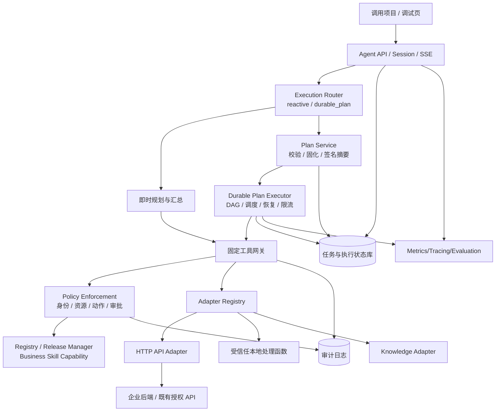
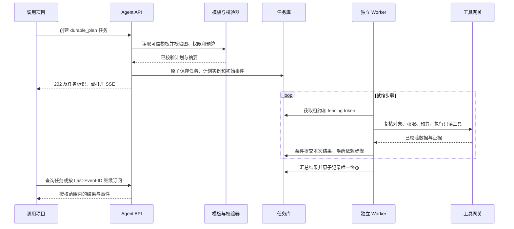
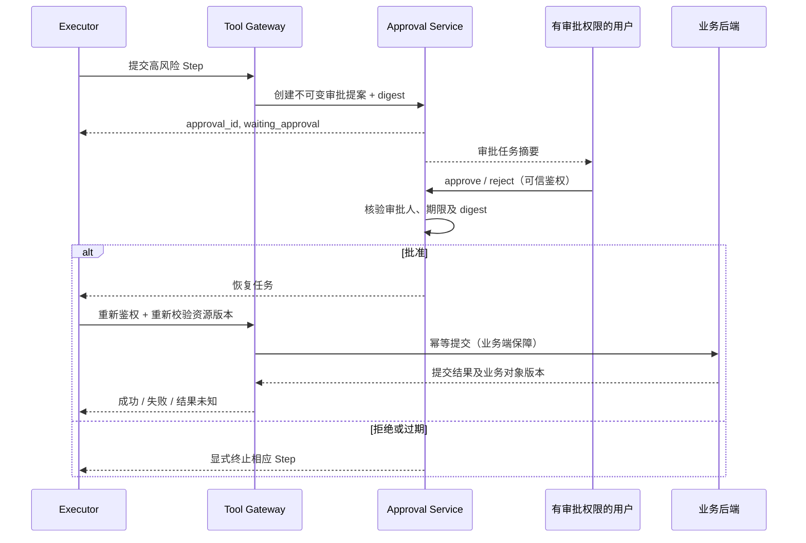

# 企业级通用 Agent 底座 · V2.0 技术设计与开发交接

**设计基线**：[V1.0](V1.0.md) 及提交 `adc3c7c`。V1 已有可运行的 Python 后端、两个可移除场景和独立项目接入模板，其历史回归为 102 项测试、12 项子测试通过。

**交付范围**：V2 本地版按 P0–P3 分阶段实现。P1 保留 V1 接口并加入可恢复任务，P2 加入独立身份审批和本地模拟账本，P3 加入发布、灰度、回滚、紧急禁用、观测与离线评测。本文保留各阶段的设计依据与备选方案；当前可执行接口及环境边界见[本地版操作手册](../v2/governance.md)和[实测记录](../verification.md)。P4 是可选研究方向。

---

## 0. 执行总则（Codex 必读）

1. 阅读基线代码、迁移与测试，记录可核查的版本、运行环境和差异。
2. 场景与调用项目各自维护业务规则。核心路径无需为场景增设条件分支。
3. 后端裁决身份、对象授权、确定性计算、状态、写入、版本和审计。
4. 保留 V1 REST/SSE 与 discover_capabilities、execute_capability、retrieve_knowledge 三个固定工具。
5. 规划仅产生候选步骤。执行和恢复以数据库状态为准。
6. P1 只允许 read 步骤。P2 通过专用本地账本适配器、显式开关和审批决定引入模拟提交。普通工具继续服从各自的动作与权限约束。
7. 发布验收报告分开列出本机实测、协议模拟和未验证项。
8. 每阶段记录差异、测试、风险与回滚办法。P2、P3 保留设计，单独验收。

### 0.1 决策摘要

| 主题 | V2 决策 | 不采用的做法 |
|---|---|---|
| 核心 Agent | 单通用 Agent，支持 reactive 与 durable_plan 两种执行模式 | 每个业务复制一个 Agent Core |
| 规划 | 服务端加载受信任场景的版本化计划模板 | 客户端指定可执行图或伪造计划标识 |
| 持久化执行 | 后端 Plan Executor + Task/Step 事件状态机 | 依赖模型的文字记忆恢复任务 |
| 业务能力 | Registry 管理版本、校验、发布和灰度；版本快照贯穿任务 | 运行期间动态切换到最新能力 |
| 权限 | Policy Decision Point + 每次工具调用的 Enforcement Point | 让 LLM 或 Manifest 决定权限 |
| 写操作 | 提案、审批、重新鉴权、执行四段式；默认关闭 | Agent 直接调用生产写接口 |
| 事件 | 保留 V1 事件，增加步骤调度、恢复及预算事件 | 转发未验证的下游原始事件 |
| 可观测性 | 受控脱敏的 Trace、指标与审计 | 记录完整敏感原文 |
| 评测 | 可复现数据集 + 运行回放 + 发布门禁 | 仅靠 demo 表现评价 Agent |
| 高级编排 | 复杂图与多 Agent 另案评估 | 无收益证据时引入额外引擎 |

---

## 1. 从 V1 到 V2：兼容性与增量范围

### 1.1 V1 继续保留的契约

- 外部：`POST /api/v1/agent/sessions`、`POST /api/v1/agent/chat`、`GET /api/v1/agent/tasks/{task_id}`、`GET /api/v1/agent/tasks/{task_id}/events`、`POST /api/v1/agent/tasks/{task_id}/cancel`。
- 内部：`POST /internal/agent/discover`、`POST /internal/agent/execute`、`POST /internal/agent/retrieve`。
- 注册与执行：场景文件 `scenario.json`、封闭的输入输出 Schema、受控 Python 或静态 HTTP 适配器、场景隔离的检索。
- 运行上下文绑定：`tenant_id / org_id / user_id / business_id / session_id / task_id / run_context_id`。
- 交付原则：`V1 API` 不因升级 V2 而强制改成 `/api/v2/agent`；兼容性破坏必须另行审议、版本化发布。

### 1.2 V2 新增能力分级

| 类别 | 增量内容 | 最低阶段 | 是否默认开启 |
|---|---|---|---|
| P0 必须 | V1 实现状态审计、迁移矩阵、基线测试 | V2-P0 | 不涉及 |
| P1 必须 | Plan/Step 状态模型、DAG 校验、持久化执行、任务恢复 | V2-P1 | 仅安全只读 |
| P1 必须 | 执行预算、调用去重、失败分类及部分结果治理 | V2-P1 | 是 |
| P2 必须 | Approval API、审批状态机、超时和拒绝处理 | V2-P2 | 先用 Mock Write |
| P2 受控 | 真实 `commit_write`；必须通过业务审批与安全前置条件 | V2-P2+ | **否** |
| P3 必须 | Registry 版本发布、回滚、灰度和兼容检测 | V2-P3 | 可灰度 |
| P3 必须 | Tracing、指标、评测集与发布门禁 | V2-P3 | 是 |
| P4 可选 | 更复杂图执行引擎或多 Agent | 另案评估 | 否 |

### 1.3 V2 完成的定义

至少满足：

1. V1 原有同步/流式会话和三固定工具入口仍能工作。
2. 一条**多步骤且具有依赖关系**的只读任务可存储、恢复、重试，并给出执行证据。
3. P2 完成后，Mock 写入审批完整走通：提案→待审批→同意/拒绝→恢复或终止，且不会重复提交。
4. P3 完成后，新能力以版本化 Registry 发布并可回滚；历史进行中的任务继续使用固化版本。
5. 不改核心路由即可新增第三个差异业务，并能运行权限测试、回归评测。
6. 可通过 request、task、step 和 execution 标识追踪执行与证据，并按授权读取审计。

---

## 2. 目标总体架构



### 2.1 权威归属与职责

| 职责 | 唯一权威 | 说明 |
|---|---|---|
| 业务资源权限 | 企业后端策略服务 | 模型输出、前端参数都不能授予权限 |
| Task/Step 状态 | 后端执行器与数据库 | 只承认经过事务提交的迁移与终态 |
| 业务能力定义/版本 | Registry 经审批发布的快照 | 存量 Task 固定版本集合 |
| 业务数据事实 | 业务系统或经授权知识源 | Agent 只归纳证据，不擅造记录 |
| 写操作最终提交 | 已授权的业务服务 | 需二次审批及业务幂等校验 |
| 业务记录版本 | 项目数据服务 | 接入层返回项目的版本与来源 |
| 审批决策 | 可信身份 + 后端审批服务 | 不采纳 LLM 自称“用户同意” |
| 多步骤调度 | 独立 Worker 与 Plan Executor | 规划结果须经校验才能入队 |

### 2.2 两种执行模式（V2 最重要的兼容设计）

**A. `reactive`。** 缺省执行模式保留 V1 短会话路径。离线或模型规划器通过授权网关获取结果，不强制为旧请求生成步骤图。

**B. `durable_plan`。** P1 从当前受信任场景的 `plan.json` 载入只读步骤模板，服务端生成 plan_id，校验并持久化实例。独立 Worker 领取就绪步骤，汇总已验证的数据与证据。

**避免双重执行。** 加载、校验模板时不得调用业务工具。Worker 才能在领取有效租约、确认预算与授权后请求网关执行步骤。客户端不能提交计划、覆盖工具绑定或指定执行器。

### 2.3 执行时序（durable_plan）



---

## 3. 核心域模型与执行语义

### 3.1 数据实体

- `AgentSession`：与用户、租户、组织、业务绑定；不允许会话串业务。
- `AgentTask`：一次用户需求执行；固定 `mode`、`status`、`release_snapshot_id`、预算、幂等键。
- `AgentPlan`：不可变执行计划，带 `plan_id`、`revision`、`digest`、`schema_version`；需要改计划时创建新 revision，经重新校验才生效。
- `PlanStep`：`step_id`、能力 ID、参数模板、依赖、并发组、状态、超时、重试、输入输出引用。
- `ToolExecution`：每次真实 Adapter 调用；含 `call_id`、尝试次数、远端业务幂等键、上游 ID、结果摘要。
- `ApprovalRequest`：业务动作提案与审批单；绑定操作者、客体、计划哈希、具体副作用、权限、有效期。
- `RegistryRelease`：通过审核的 Business/Skill/Capability 版本集合；Task 绑定快照。
- `EvaluationRun`：一次回归评测记录；固定用例集、模型/提示词/工具版本、统计结果与工件。

### 3.2 Task 状态机

| 状态 | 语义 | 终态 | 与 V1 的关系 |
|---|---|---|---|
| `pending` | 已接收，待规划或调度 | 否 | 原设计预留，V2 调度目标 |
| `planning` | 规划中，尚无合法执行计划 | 否 | 新增 |
| `running` | 计划执行中 | 否 | 保留 |
| `waiting_approval` | 等待审批决策 | 否 | V2-P2 目标 |
| `suspended` | 因可恢复外部问题暂停 | 否 | 新增 |
| `completed` | 全部必需步骤成功 | 是 | 保留 |
| `partial` | 可独立消费的部分结果；失败显式列出 | 是 | 保留 |
| `failed` | 任务不能形成合格结果 | 是 | 保留 |
| `cancelled` | 已确认停止后续调度 | 是 | 保留 |

**典型合法迁移**：`pending → planning → running → completed/partial/failed`；`running → waiting_approval → running/failed/cancelled`；`running → suspended → running/failed/cancelled`。非法迁移返回 `409 TASK_STATE_CONFLICT`。所有迁移使用数据库事务/CAS 乐观锁控制，禁止并发重复终态。

### 3.3 Step 状态机

`blocked → ready → leased → running → succeeded / failed / skipped / waiting_approval / outcome_unknown`。

- `blocked`：依赖未满足；`ready`：所有成功依赖已满足；`leased`：Worker 已取得短租约；`running`：执行中。
- `waiting_approval`：步骤等待外部批准，不占用 Worker；批准后重新入队。
- `outcome_unknown`：上游返回不明，必须先按业务幂等键查询真实结果，**不得自动盲目重试写操作**。
- `skipped`：依赖失败或分支条件不满足，带明确 reason，不得计算为 succeeded。
- 同一 `step_id` 的成功结果只能提交一次；重放/恢复必须检测已落库结果。

### 3.4 结果治理

- `completed` 仅在全部 required 步骤成功且最终聚合 Schema 合格时返回。
- `partial` 必须包含 `failed_steps`、`missing_outputs` 和 `limitations`，且不应包含未经验证的业务结论。
- 涉及关键权限失败、敏感泄露、数据完整性校验失败时应 `failed`，不能降级为 `partial`。
- 不把“模型写出的 JSON”视为工具已执行。任何工具成功需要 `ToolExecution` 证据及输出 Schema 验证。

---

## 4. 结构化 Plan DSL（后端目标协议）

### 4.1 项目简报的只读计划模板

以下示例与仓库内的 [plan.json](../../examples/durable/scenarios/project_brief/plan.json) 等价。它与场景清单、适配器及测试资料一起发布。首次提交时由服务端生成 task_id 和 plan_id，模板和调用请求均不指定这两个标识。

```json
{
  "schema_version": "2.0",
  "result_contract": "summary_v1",
  "steps": [
    {"step_id": "progress", "capability_id": "read_progress", "arguments": {"text": {"$message": true}}},
    {"step_id": "risks", "capability_id": "read_risks", "arguments": {"text": {"$message": true}}},
    {
      "step_id": "brief", "capability_id": "compose_brief", "depends_on": ["progress", "risks"],
      "arguments": {
        "progress": {"$step_output": "progress", "path": "/data/summary"},
        "risks": {"$step_output": "risks", "path": "/data/summary"}
      }
    }
  ]
}
```

省略 `required` 时视为必需步骤，省略 `depends_on` 时视为空数组。`$message` 绑定本次请求文本。前驱结果只允许通过 `$step_output` 和白名单 JSON Pointer 引用，不能在模板中执行函数、SQL 或脚本。服务端应用预算、生成摘要并冻结经校验的实例。

### 4.2 Plan Validator 必须实现的校验

1. 整体 JSON Schema 校验，拒绝未知字段和超长描述；`schema_version` 明确可兼容范围。
2. `step_id` 唯一，DAG 不含循环或悬空依赖；拓扑排序结果可复现。
3. `capability_id` 属于该 Task 的发布快照及*实际授权集合*；不得跨业务任意调用。
4. 每个 Step 的 `arguments` 经引用解析后满足目标输入 Schema，枚举/类型必须严格检查。
5. `"$step_output"` 引用必须来自 `depends_on` 的传递前驱，并且路径处于对外可用字段集合；引用解析在 Step 就绪时进行，失败需有明确错误。
6. Step 总数、最大边数、最大深度、并行度、总计划预算均受后端策略控制；示例开发默认 12 步、并行 3、深度 6（**拟定配置，不是生产容量结论**）。
7. 不允许模型决定 `permission_code`、`adapter_ref`、接口地址、重试次数或实际预算上限。
8. V2-P1 计划的所有工具均须为 `read`。注册但不符合该限制的能力在校验阶段被拒绝；审批提案与正式写入仅在 P2 单独讨论。
9. 若允许 Step 条件分支，V2 最小版仅支持后端审核的有限条件谓词（如 equals/is_present），不执行任意表达式；首轮可不实现条件分支。
10. 计划校验失败只允许按有界策略重新规划；达到重试次数后返回明确 `PLAN_INVALID`，禁止无限循环。

### 4.3 并行与共享上下文

- 两个 Step 均为 `ready` 且没有写冲突才可并行；不得把共享可变对象直接传给并行分支。
- `progress` 和 `risks` 可同时领取。`brief` 的两个前驱均成功且输出可经 `/data/summary` 解析为字符串后，才能调用 `compose_brief`。
- 每个 Step 参数是其执行开始时从不可变快照计算的；同一任务的证据有明确版本/时间来源。
- 对失效的授权、预算或数据版本必须中断后续调度，不因已经规划就继续执行。

### 4.4 规划器抽象接口

```python
class Planner(Protocol):
    async def propose_plan(self, *, goal, allowed_capabilities, context, constraints) -> dict: ...

class PlanValidator(Protocol):
    def validate(self, *, candidate, policy_snapshot, release_snapshot) -> "ValidatedPlan": ...

class PlanExecutor(Protocol):
    async def schedule(self, task_id: str) -> None: ...
    async def resume(self, task_id: str) -> None: ...
```

- P1 从本地可信场景加载声明式计划模板，可以用确定性输入验证 DAG，无需模型或外部服务。
- 服务端负责实例标识、版本快照和输入绑定；客户端不能指定未发布能力。
- 复杂规划器可在以后实现同一接口，仍需经过校验器。

---

## 5. 可靠任务执行（Durable Execution）

### 5.1 存储、队列和 Worker

- 生产建议 `PostgreSQL` 维护事务性 Task/Step/Approval/Event；可选 Redis / 消息队列负责分发，但**不能把消息队列当作唯一状态来源**。
- 采用 Outbox 或同等机制保证“更新状态 + 发布任务”的可靠性；消息可能重复投递，执行必须幂等。
- Worker 以 `lease_owner + lease_expires_at + fencing_token` 抢占 Step；租约续期、进程退出与超时恢复由后端调度器负责。
- 对同一业务执行产生外部副作用的 Step，必须实现持久化的调用幂等保护、状态查证及必要时的业务补偿设计。**无法保证下游幂等/查询能力时不开放自动写入**。
- P1 的 API 与独立 Worker 共享本机 SQLite。恢复试验启动两个竞争 Worker 并中断其中之一。生产数据库、任务队列、高可用和压力测试须在后续目标环境重新验收。

### 5.2 重试分类表

| 场景 | 自动重试 | 原则 |
|---|---|---|
| 网络临时失败、上游 429、可恢复 503 | 有界重试，仅幂等操作 | 指数退避 + 抖动；遵循 Retry-After |
| 输入 Schema 错误 | 否 | 明确报告 `SCHEMA_VALIDATION_FAILED` |
| 资源/权限拒绝 | 否 | `PERMISSION_DENIED`，记录审计 |
| 输出 Schema 错误 | 原则上否；可按能力专属策略重做纯分析 | 不将脏输出标成功 |
| 只读请求已确认无副作用且超时 | 按配置 | 限制最大次数和请求预算 |
| 写请求超时结果未知 | **禁止盲目重试** | 先用幂等键查询原结果；无法确认进入人工处理 |
| 审批已拒绝/过期 | 否 | 流程终止，不转化为执行许可 |

### 5.3 预算与熔断

Budget 字段受服务端策略限制：`max_steps`、`max_tool_calls`、`max_parallel_steps`、`deadline_ms`、`max_tokens`、`estimated_cost_limit`。模型只能提出较低预算，不能上调上限。

支持任务级超时、业务级速率限制、Adapter 熔断和恢复、请求级 kill switch（停止*后续*调用）。取消无法撤销已完成的外部操作，最终响应必须体现真实业务结果和取消时点。

### 5.4 恢复算法要点

1. 扫描处于 `running/suspended/waiting_approval` 的未完成 Task。
2. 对 `running` Step 检查租约并判定是否需要查证上游执行结果。
3. `succeeded` 的 Step 永不重新执行；`ready`/有条件恢复的 Step 重新入队。
4. 对已失效、被撤销的权限或注册版本不继续执行；禁止“历史授权永久有效”。
5. `waiting_approval` 由审批事件驱动恢复，不做无限轮询模型。
6. Task 终态及事件采用数据库原子写入；最终 SSE 重放只能看见唯一 terminal event。

---

## 6. 人工审批与可控写入（P2 设计）

### 6.1 风险动作矩阵

| 动作类型 | 含义 | 默认策略 |
|---|---|---|
| `read` | 查询授权数据 | 允许，须持续鉴权 |
| `propose_write` | 生成改稿建议/草案，不提交正式业务 | 允许，仍需输出校验 |
| `commit_write` | 修改权威记录或产生外部副作用 | **默认拒绝**，仅白名单逐项开通 |

如将来确需正式写入，执行必须经过 `proposal → approval → revalidate → commit → verify`；用户的自然语言“可以了”**不能自动等同于审批**。

### 6.2 审批单绑定信息

一张审批单至少绑定：`approval_id`、`task_id`、`step_id`、`business_id`、`capability_id/version`、`subject_id`、`target_object_ids`、`action_summary`、`payload_digest`、`plan_digest`、`release_snapshot_id`、`expires_at`、`approval_policy_id`、`required_approver_rule`。

以下任何一种变化应使旧审批无效：执行动作变更、业务对象变更、参数摘要变更、能力版本变更、审批过期、审批人权限被撤销、任务取消、资源状态不再满足提交前置条件。

### 6.3 审批生命周期

`requested → approved / rejected / expired / cancelled`（审批终态不可更改）；`approved` 不等于已执行，另有 `commit_status = not_started / in_progress / succeeded / failed / outcome_unknown`。

- 审批请求仅展示安全摘要和字段差异，屏蔽令牌、敏感原文及其他组织的数据。
- 审批者必须具有独立审批权限；是否禁止申请人自批由具体业务策略确定，默认采用职责分离。
- 同一审批只能被终结一次；同意后重放相同请求不会重复执行业务写入。
- 审批完成后重新校验当前对象版本（乐观锁/ETag）、实际权限、业务限制及幂等键，再通过业务后端执行。
- 真实 `commit_write` 不纳入首轮必做；V2-P2 先实现本地模拟写入，验证状态与安全闭环。

### 6.4 审批执行时序



---

## 7. Registry 版本治理与业务接入升级（P3 设计）

### 7.1 Release 机制

- `draft`：可编辑但不能被生产 Agent 发现。
- `validated`：Schema、依赖、权限映射、适配器签名与测试均校验通过。
- `staged`：进入发布候选；允许环境级测试。
- `active`：对符合灰度规则的新 Task 生效。
- `deprecated`：禁止新任务选择，但未结束 Task 可使用快照继续受控执行。
- `revoked`：紧急禁用，即使旧 Task 固定快照也必须拒绝继续调用受影响能力。

### 7.2 版本冻结与兼容性

- `business_version` / `skill_version` / `capability_version` / `schema_version` / `adapter_release` 由 `release_snapshot_id` 固化。
- 运行期间禁止静默从 `read_local_record@1.0.0` 漂移到 `@2.0.0`。
- 兼容性检查至少覆盖：必填字段变化、类型/枚举收紧、输出字段删除、能力权限等级提升、超时/重试语义变化、证据结构变化。
- 破坏性更改需并行发布新版 Capability ID 或 Major Version，不得无审批覆盖旧版。
- 为避免安全版本锁死，**权限撤销、紧急禁用和安全策略收紧始终实时生效**，不受冻结版本豁免。

### 7.3 推荐扩展 Manifest

```json
{
  "capability_id": "read_local_record",
  "business_id": "record_fixture",
  "version": "2.0.0",
  "action_level": "read",
  "adapter_type": "http_api",
  "adapter_ref": "local.records.read.v2",
  "input_schema_ref": "record_read.v2.input.schema.json",
  "output_schema_ref": "record_read.v2.output.schema.json",
  "permission_code": "records.read",
  "release_policy": {
    "stage": "staged",
    "canary_percent": 10,
    "rollback_to": "1.0.0"
  },
  "execution_policy": {
    "timeout_ms": 10000,
    "max_retries": 1,
    "idempotency_required": true
  },
  "evaluation_suite": "record_read_regression_v2"
}
```

> 这里的 `canary_percent` 仅是预设发布策略，**不是客户端或模型可传参数**。灰度选择由服务端对可信租户/业务标识做稳定哈希或白名单，避免一个任务不同 Step 命中不同版本。

### 7.4 Registry 发布 API（管理面，非 Agent Tool）

| 方法 | URI | 操作方 |
|---|---|---|
| `POST` | `/api/v1/agent-admin/releases/validate` | 管理员/CI 服务 |
| `POST` | `/api/v1/agent-admin/releases` | 授权发布者 |
| `POST` | `/api/v1/agent-admin/releases/{release_id}/activate` | 授权发布者 + 审批策略 |
| `POST` | `/api/v1/agent-admin/releases/{release_id}/rollback` | 授权发布者 |
| `GET` | `/api/v1/agent-admin/releases/{release_id}` | 已授权审计/运维 |
| `POST` | `/api/v1/agent-admin/capabilities/{id}/revoke` | 安全管理员紧急禁用 |

管理 API 与普通对话接口采用独立权限域、鉴权策略、审计日志；不得注册为可由 LLM 直接调用的业务 Capability。

### 7.5 业务接入流程（正式 SOP）

1. 明确新业务边界：对象 ID、机构/租户作用域、权限码、读写性质和主数据来源。
2. 输出 Business/Skill/Capability Manifest、输入输出 Schema 和示例用例。
3. 把 Tool Adapter 指向**已批准的服务端静态端点**，真实密钥置于 Secrets Manager。
4. 建立安全测试：越权、伪造身份、错误资源 ID、敏感字段、工具输出注入。
5. 建立质量评测集：正确路由、必要证据、拒答/澄清、超时降级。
6. 通过 `validate → staged → canary → active` 发布，固化 Release Snapshot。
7. 全量回归 V1 和 V2 主流程，确认 通用运行时 和三个固定工具入口无业务特判。
8. 发布后监控错误率、成本、延迟与越权拒绝；超阈值自动暂停灰度或人工回滚。

---
## 8. 前端 / 后端标准 API（完整增量契约）

### 8.1 总体约定

- P1 沿用本地 Bearer 令牌与主体授权映射。生产接入时由企业身份系统签发或验证令牌。两种情况下均拒绝请求体自报身份。
- `Idempotency-Key` 适用于创建任务、提交审批和写动作；后端按身份/业务范围维护请求哈希和去重记录。
- 任务记录可凭 `request_id` 追溯。即时请求错误沿用 V1 的 `request_id` 与 `error` 对象，其中包含 `code`、`message`、`retryable`、`details`。已接受的异步任务失败时，在任务记录和事件流中报告。
- 公开响应应去除服务密钥、内网地址、敏感日志与其他租户标识。
- V1 原 `response_mode=blocking|streaming` 不变；V2 新增可选 `execution_mode=reactive|durable_plan`，默认 `reactive` 保持兼容。
- SSE 继续使用 `id`、`event` 和含 `task_id` 的 JSON `data`。Trace 可查询事件时间戳；同一任务不得重复生成终态事件。

### 8.2 创建多步骤任务

**`POST /api/v1/agent/chat`**（兼容扩展）

```http
POST /api/v1/agent/chat
Authorization: Bearer <user_access_token>
Idempotency-Key: 8b52d0a7-18a7-4f75-bb5c-001
Content-Type: application/json
```

```json
{
  "business_id": "project_brief",
  "message": "请为本周项目准备一份简报。",
  "execution_mode": "durable_plan",
  "response_mode": "streaming"
}
```

对 `durable_plan`，非流式提交返回 `202 Accepted` 及任务标识，调用方查询状态和结果；流式提交返回 `200 text/event-stream`。旧 `reactive` 的阻塞和流式语义保持不变。

以下节选省略中间事件，ID 间隔仅作示意。

```text
id: 1
event: task_started
data: {"task_id":"task_001","session_id":"ses_001","status":"planning","execution_mode":"durable_plan"}

id: 2
event: plan_validated
data: {"task_id":"task_001","plan_id":"plan_001","revision":1,"step_count":3}

id: 3
event: step_started
data: {"task_id":"task_001","step_id":"progress","capability_id":"read_progress"}

id: 20
event: task_completed
data: {"task_id":"task_001","status":"completed","result":{"answer":"简报已生成。"}}

```

### 8.3 获取 Task 详情

下例展示 P2 启用审批后的目标响应，涉及另一项需审批的任务。P1 的只读任务不会进入 waiting_approval。

**`GET /api/v1/agent/tasks/{task_id}`**

```json
{
  "request_id": "req_001",
  "task_id": "task_001",
  "session_id": "ses_001",
  "business_id": "record_fixture",
  "execution_mode": "durable_plan",
  "status": "waiting_approval",
  "release_snapshot_id": "release_20261022_001",
  "plan": {
    "plan_id": "plan_001",
    "revision": 1,
    "steps_total": 3,
    "steps_succeeded": 2,
    "steps_failed": 0
  },
  "pending_approvals": ["apr_001"],
  "answer": null,
  "artifacts": [],
  "evidence": [],
  "error": null
}
```

注意：前端可看见的 `plan` 是*经过权限裁剪后的展示摘要*，不得暴露未授权对象和内部参数；`release_snapshot_id` 为追踪标识，不是越权读取 Registry 的凭据。

### 8.4 计划与步骤详情

| HTTP | URI | 功能 | 鉴权 |
|---|---|---|---|
| GET | `/api/v1/agent/tasks/{task_id}/plan` | 获取本任务已批准的计划展示图，必要字段脱敏 | Task 所属用户/角色 |
| GET | `/api/v1/agent/tasks/{task_id}/steps` | 获取授权的 Step 状态与失败原因 | Task 所属用户/角色 |
| GET | `/api/v1/agent/tasks/{task_id}/events` | SSE 重放/订阅，可用 `Last-Event-ID` | 同上 |
| POST | `/api/v1/agent/tasks/{task_id}/cancel` | 请求取消后续调度 | Task 操作权限 |
| POST | `/api/v1/agent/tasks/{task_id}/resume` | 恢复满足条件的已挂起任务 | Task 操作权限；不能绕过审批 |

`resume` 只能恢复允许自动重试的失败/中断状态；不能把 `failed/cancelled/completed` 终态强行转为 `running`。需重新运行的业务应创建新 Task 并记录 `parent_task_id`。

### 8.5 审批列表与审批决定（P2）

**`GET /api/v1/agent/approvals?status=requested`**：仅列出当前用户有权审批的安全摘要，需分页和审计。

**`GET /api/v1/agent/approvals/{approval_id}`**：返回提案、业务对象、安全差异、有效期和实际审批资格（由后端计算）。

**`POST /api/v1/agent/approvals/{approval_id}/decision`**：

```http
POST /api/v1/agent/approvals/apr_001/decision
Authorization: Bearer <approver_access_token>
Idempotency-Key: approval-apr_001-decision-1
Content-Type: application/json
```

```json
{
  "decision": "approve",
  "proposal_digest": "sha256:8be3b...example",
  "comment": "已核对目标对象和字段"
}
```

```json
{
  "approval_id": "apr_001",
  "approval_status": "approved",
  "task_id": "task_001",
  "task_status": "running",
  "decided_at": "2026-10-22T11:12:00+09:00"
}
```

- `decision` 仅 `approve` / `reject`；`proposal_digest` 不匹配必须 `409 APPROVAL_PROPOSAL_CHANGED`。
- `approve` 不是立即声明写入成功；需待 Worker 完成 `commit/verify`。
- 前端无法通过传入 `approver_id` 或 `tenant_id` 决定审批身份。
- 若要求审批者在操作时再次输入强认证（MFA/二次确认），由企业 SSO / 后端政策决定。

### 8.6 内部 Tool Gateway 扩展（保留 V1 三工具）

V1 固定工具保持不变。`/internal/agent/execute` 允许新增**可选**执行元信息：

```json
{
  "run_context_id": "ctx_001",
  "capability_id": "read_progress",
  "arguments": {"text": "请为本周项目准备一份简报。"},
  "call_id": "step-progress",
  "execution_context": {
    "task_id": "task_001",
    "plan_id": "plan_001",
    "step_id": "progress",
    "release_snapshot_id": "release_20261022_001"
  }
}
```

`execution_context` 中的 ID 均是*待核验声明*；网关必须从持久化可信 `run_context_id` 及 Task/Plan 快照独立校验匹配，不能据此越权或绕过状态机。`call_id` 对同一 Step 的逻辑执行保持稳定；尝试次数应由独立 `attempt_no` 记录，**不能每重试一次换一个可绕过幂等的新业务写入键**。

### 8.7 新增 SSE 事件

| 事件 | 必填内容 | 前端行为 |
|---|---|---|
| `plan_started` | task_id | 展示规划中 |
| `plan_validated` | task_id, plan_id, revision, step_count | 展示计划摘要 |
| `plan_rejected` | task_id, error | 显示规划失败/可澄清 |
| `step_queued` | task_id, step_id | 步骤待执行 |
| `step_retrying` | task_id, step_id, attempt, error_code | 展示重试与状态 |
| `step_suspended` | task_id, step_id, reason | 显示待恢复 |
| `approval_required` | task_id, approval_id, action_summary, expires_at | 显示审批操作入口 |
| `approval_decided` | task_id, approval_id, decision | 更新审批状态 |
| `task_suspended` | task_id, reason | 显示任务暂停 |
| `task_resumed` | task_id | 更新任务状态 |
| V1 原事件 | task_started, step_started, step_completed, step_failed, message_delta, task_completed, task_failed, task_cancelled | **持续保留** |

SSE 恢复语义：事件写库与发送可存在时间差；`Last-Event-ID` 只重放数据库中该任务的授权事件，客户端按事件 ID 去重；最终答复不能与 `message_delta` 重复拼接。流中发生错误必须通过 `task_failed` / `step_failed` 显式传递，不能仅依赖 HTTP 初始状态。

### 8.8 错误码增量

| HTTP | 错误码 | 场景 |
|---|---|---|
| 400/422 | `PLAN_INVALID` / `PLAN_CYCLE_DETECTED` | 计划 Schema 或 DAG 不合法 |
| 403 | `CAPABILITY_REVOKED` | 能力紧急禁用 |
| 403 | `WRITE_ACTION_DISABLED` | 写操作开关或白名单未开放 |
| 403 | `APPROVAL_PERMISSION_DENIED` | 当前身份不能审批该单 |
| 404 | `PLAN_NOT_FOUND` / `APPROVAL_NOT_FOUND` | 不存在或不可见资源 |
| 409 | `APPROVAL_ALREADY_DECIDED` / `APPROVAL_PROPOSAL_CHANGED` | 审批冲突或提案已变 |
| 409 | `OBJECT_VERSION_CONFLICT` | 目标业务对象版本变化 |
| 409 | `RELEASE_VERSION_CONFLICT` | Registry 发布竞争 |
| 422 | `STEP_OUTPUT_REFERENCE_INVALID` | Step 引用路径或类型不合法 |
| 422 | `EVALUATION_GATE_FAILED` | 发布评测不通过 |
| 429 | `EXECUTION_BUDGET_EXCEEDED` | 调用/成本/时间预算耗尽 |
| 503 | `TASK_SUSPENDED` | 需等待恢复的上游依赖故障（仅用于同步请求） |
| 504 | `STEP_TIMEOUT` | 单步骤超时 |
| 500/502 | `OUTCOME_UNKNOWN` | 已执行动作结果无法确认，需要人工查证 |

对于异步 Task，创建请求返回成功后出现上述故障，**不要更改先前的 HTTP 状态**；存储至 Step/Task 的标准化 `error` 并经 SSE 通知。HTTP 映射用于即时拒绝、直接调用或管理接口；具体需以 V1 已有契约为准。

---

## 9. 数据模型、事务边界与数据库迁移

### 9.1 以 V1 表结构为基础增量扩展

V1 基线的 SQLite 表为 `sessions`、`tasks`、`task_permissions`、`runs`、`calls`、`events`、`idempotency` 和 `audit_logs`。下表列出 V2 逻辑实体、建议物理约束与后续阶段表；实施须以仓库迁移和测试为准。

V2 应新增：

| 表 | 关键字段 | 必要索引/约束 |
|---|---|---|
| `agent_plans` | plan_id, task_id, revision, digest, schema_version, plan_json, status | `(task_id, revision)` 唯一；`plan_id` 主键 |
| `agent_plan_steps` | task_id, step_id, capability_id, capability_version, status, required, dependency_json, output_json, lease_owner, lease_expires_at, fencing_token, row_version | `(task_id, step_id)` 唯一；ready/lease 索引 |
| `agent_step_attempts` | attempt_id, task_id, step_id, attempt_no, call_id, remote_idempotency_key, started_at, completed_at, error_code | `(task_id, step_id, attempt_no)` 唯一 |
| `agent_approvals` | approval_id, task_id, step_id, plan_digest, proposal_digest, payload_encrypted_ref, status, commit_status, expires_at, decided_by, decided_at | `approval_id` 主键；待审批索引 |
| `agent_registry_releases` | release_id, business_id, manifest_digest, status, created_by, activated_at, rollback_to | 业务+版本/摘要唯一 |
| `agent_release_bindings` | tenant_scope, business_id, release_id, channel, rollout_config | Scope+业务+channel 唯一 |
| `agent_evaluation_runs` | eval_run_id, suite_id, release_id, planner_version, passed, metrics_json, artifacts_ref | eval_run_id 主键 |
| `agent_outbox` | outbox_id, aggregate_id, event_type, payload_json, published_at | 未发布索引；幂等消息 ID |

保留历史记录及主键。P1 仅增加只读计划、步骤、尝试和租约执行所需结构，P2/P3 表留待对应阶段。

### 9.2 一致性原则

- 状态更新必须携带 `row_version` 或同等 CAS 条件，避免两个 Worker 都完成相同 Step。
- 创建审批与把 Step 标为 `waiting_approval` 在同一数据库事务中完成；审批通知通过 Outbox 异步投递。
- 任务事件的 `event_id` 应以 Task 为作用域单调递增，可用行锁/序列表；SSE 顺序以持久化序号为准。
- 业务写入的幂等性在企业业务后端强制保证，Agent 本地调用记录不能替代下游幂等约束。
- `payload_encrypted_ref` 指向受控加密存储；常规审计表不得保存敏感原文或明文 Token。
- 跨组织查询默认拒绝；若支持数据库级 RLS，可作为二次防护，但应用层授权不可省略。

### 9.3 推荐迁移策略

1. 先检查现存表和迁移版本；生成现状 `schema diff`。
2. 先添加 nullable / 默认字段与新表，保证旧服务可运行。
3. 新服务双读或单读新结构，验证与 V1 对齐；必要时只为 Task 状态添加受控兼容映射。
4. 在灰度下验证恢复和事件回放；完成之后再考虑收紧非空约束。
5. 回滚脚本原则上只回滚应用版本与 release binding，不自动丢弃新产生的 Task/Approval 数据。

---

## 10. 安全、权限、供应链与模型防护

### 10.1 权限模型

授权决策至少由以下因素决定：

`subject (tenant, org, user, role)` + `business_id` + `resource_type/id` + `capability_id/version` + `action_level` + `environment` + `approval_policy` + `current_resource_version`。

- `discover` 权限过滤**不替代** `execute` 再鉴权。
- Registry Release/Plan Snapshot 固化功能版本，**不固化权限授权**；执行每步都重新确认用户/组织权限及资源访问。
- 同一 Step 的数据输出可带 `data_classification`、`source_permission_scope`，高密级结果不应进入其他低密级步骤。
- 特殊跨组织数据共享需要企业后端显式授权证明；不能从会话历史推断。

### 10.2 提示词注入与外部数据隔离

- 上传文档、OCR、检索片段与工具响应都是待分析数据，不能覆盖系统约束。
- 对 Plan 必须做后端白名单/JSON Schema/DAG/策略检查；“模型承诺安全”不构成安全控制。
- Tool 输出同时带证据元数据与可信等级（如 `source_type`, `source_id`, `source_version`, `classification`）；用户回复只引用已授权证据。
- 禁止接收用户控制的任意 `endpoint_url`、`headers`、`Authorization`、SQL、脚本、HTTP Method 等执行字段。
- 输出到前端前进行 Markdown/HTML 安全渲染、危险链接校验和必要的敏感信息脱敏。

### 10.3 可选工具协议适配

后续若需连接独立工具服务，服务地址、工具清单、授权作用域和协议版本须由发布者审核。传输层身份和业务对象权限分别验证，令牌受众与资源绑定一致，不转发全权限令牌。适配器公布读写等级、超时、输入输出 Schema 和审计字段。P1 仅保留这一边界。

### 10.4 真实写操作上线前置清单

任一条件不满足，`commit_write` 不得开启：

1. 后端有可查证的权限和业务对象版本校验。
2. 业务接口有可靠幂等键或可查证的业务事务 ID。
3. 权限与审批链路在真实认证中闭环。
4. 成功/失败/超时结果能查证，未知结果有安全的人工处理 SOP。
5. 全量记录审计主体、对象、请求摘要和实际最终结果。
6. 已通过恶意提示词、跨租户、重放、并发审批、参数篡改、断线重连的安全测试。
7. 已经建立 kill switch 和紧急停用机制。

---

## 11. 可观测性、质量评测和成本治理（P3 设计）

### 11.1 Tracing 字段设计

P3 设计用 OpenTelemetry 连接 API、规划、校验、执行、授权、网关和项目适配器的观测数据。

推荐 Span：`agent.request`、`agent.plan`、`agent.step`、`agent.tool`、`agent.approval`、`agent.adapter`、`agent.response`。服务间以标准 trace context 传播，不把 trace ID 当作权限凭据。

至少记录：`trace_id`、`span_id`、`request_id`、`task_id`、`step_id`、`execution_id`、`business_id`、`capability_id/version`、`release_id`、`outcome`、`duration_ms`、`error_code`、`model_id`、`planner_id`、`token_usage`（可获得时）、`cost_estimate`（可获得时）。

原则上不采集或导出完整用户输入/资料正文/隐私明文；必要时按数据分类显式开启、脱敏和限定保留期。OpenTelemetry GenAI 语义规范仍可能处于开发状态，字段命名要由版本化适配层负责，不应作为不可变业务 API。

### 11.2 运营指标建议

| 维度 | 指标 | 计算口径 |
|---|---|---|
| 效用 | `task_completion_rate` | completed / 已结束任务数 |
| 效用 | `task_partial_rate` | partial / 已结束任务数 |
| 稳定性 | `step_error_rate` | 失败尝试 / 总尝试（独立于最终 Task 成功） |
| 稳定性 | `recovery_success_rate` | 恢复后成功的可恢复任务 / 发起恢复的任务 |
| 体验 | `first_event_latency_ms` | API 接收到首个用户可见 SSE 事件的耗时 |
| 体验 | `task_latency_p95` | 已结束任务耗时 P95，分 execution_mode |
| 成本 | `token_cost_per_task` | 按实际模型 Token / 单价计算，数据缺失标记 estimated |
| 成本 | `tool_calls_per_task` | 一次 Task 的逻辑 ToolExecution 数量 |
| 安全 | `permission_denial_count` | 被后端拒绝的资源/能力调用数 |
| 审批 | `approval_wait_time` | 决策时间减申请时间，含失效统计 |
| 质量 | `evidence_coverage_rate` | 需证据的结论中具有授权来源的比例 |
| 质量 | `routing_accuracy` | 基准评测中正确选择能力的样本比例 |

### 11.3 评测集结构

评测样本至少包含：`case_id`、`business_id`、`input`、`context_fixture`、`expected_capabilities`、`expected_status`、`expected_evidence_refs`、`allowed_variants`、`security_expectations`、`golden_version`。

评测覆盖路由、依赖、引用、错误输出、跨租户、审批重放、超时、恢复、注入、无证据回答、SSE 兼容、版本回滚与成本上限。

### 11.4 发布门禁（首批建议阈值，可据基线校准）

| Gate | 建议默认验收 | 备注 |
|---|---|---|
| 协议测试 | 100% 通过 | 必须，不能用加权平均豁免 |
| 跨租户 / 越权测试 | 100% 拒绝成功 | 必须，不允许“偶发可访问” |
| 写动作未审批执行测试 | 0 次 | 必须 |
| Plan Schema / DAG 检测 | 100% 拦截全部非法样本 | 必须 |
| 任务幂等测试 | 同逻辑提交至多一次下游副作用 | 必须 |
| 历史回归集 | 不得出现新增 P0/P1 缺陷 | 基线不存在时先建立 |
| 评测路由正确率 | ≥ 95%（建议） | 需真实样本集后校准 |
| 需证据回答覆盖率 | ≥ 98%（建议） | 不代表证据正确，需抽检 |
| 生产 SLA、P95 | **不预设绝对毫秒阈值** | 先测出基线后由业务方确认 |

按 offline、staging、production 分组呈现结果，避免混合成功率。模型质量须复核标签、非确定性误差和样本泄漏。

### 11.5 仪表盘与告警建议

- 监控平台每个 Business 的错误码 Top N、Task 状态分布、Tool 延迟、Token 花费、审批积压、SSE 断连、版本分布。
- 高危告警：疑似跨租户数据泄漏、未审批写入、能力大面积异常、Step 重复实际执行、审批重放成功、审计断链。
- 模型不可用时，生产只采用经批准的规则降级或明确返回失败。本地离线模板的测试结果单独标注。

---

## 12. 第三个独立项目的扩展验收（P3 目标）

### 12.1 用例

从仓库外的项目目录加载异构只读工具和测试数据。用户要求核对两份记录时，两个读取步骤可以并行，后续摘要仅引用已成功且仍获授权的来源。记录不存在时保留空结果、原因及影响范围。

### 12.2 项目边界

项目负责对象授权、版本与原始记录。适配器定义输入、返回结构和缺失语义；测试分别覆盖无权、无数据、格式损坏、超时。没有经核实的接口时只提供本机 fixture。

### 12.3 差异证据

比较接入前后 Git Diff，将新增的场景清单、适配器、数据和测试与通用代码分开。记录复现命令，确认核心及固定三工具没有基于场景 ID 增加分支。具体项目可替换，不作为 P1 固有依赖。

---

## 13. 研发阶段与逐阶段验收门槛

### V2-P0：现状审计 + 升级差异矩阵

**输入**：`adc3c7c` 的源码、V1 接口记录、当前环境与只读计划的设计约束。

**审计交付**：可合并在[升级基线与边界](../v2/upgrade-baseline.md)中记录模块和接口现状、V1 与 V2 的差异、安全和部署决策，以及旧请求、任务查询、三工具和 SSE 断点续读的回归证据。

**门槛**：针对 adc3c7c 已有实现核对兼容测试，并将超出基线的要求归入相应阶段。

### V2-P1：多步骤可靠执行（默认第一个开发阶段）

范围：计划模板、DAG 验证、任务/计划/步骤持久化、独立 Worker 与租约、只读网关、事件重放、恢复、预算和有界重试。P1 不连接外部系统。

**必须交付**：

- 至少一条 3-Step DAG：两个可并行 Step + 一个依赖 Step。
- 进程中断/两个 Worker 的恢复测试。
- `PLAN_CYCLE_DETECTED`、非法字段、悬空依赖、恶意 capability ID、越权对象测试。
- V1 reactive 回归：固定三工具入口仍可工作。
- Swagger/OpenAPI、`.env.example`、`docker-compose`（如采用）、本地运行脚本和 Demo。

**Gate**：计划依赖正确、终态唯一、成功 Step 不重复执行、异常明确、两个 Demo 业务不回归。

### V2-P2：人工审批与受控写操作（先 Mock）

范围：ApprovalRequest、审批 API、审批变更摘要与哈希、审批状态机、拒绝/过期、恢复执行、重放保护、对象版本再校验。

**必须交付**：

- Mock Write 全闭环，审批通过后一次且仅一次执行；拒绝后绝不执行。
- 非审批者、跨租户、重复审批、审批参数变化、审批过期、Task 取消的负向测试。
- 真正写入的 feature flag 默认 `false`，文档显式提示未启用。

**门槛**：未经审批不能执行写入，审批人与实际执行者均能通过审计查证。真实写入的授权另行申请。

### V2-P3：版本治理 + Observability + Evals

范围：Release Manager、Manifest 校验/兼容性检查、staged/canary/rollback、OpenTelemetry 指标链路、质量评测、发布门禁。

**必须交付**：

- 版本升级和回滚演示：在运行 Task 使用旧快照，新 Task 依据灰度策略选新版。
- 版本紧急禁用后旧任务也不能继续调用被 revoke 的 Capability。
- 至少三个差异业务；第三业务的扩展性 Git Diff 验证。
- 评测报告、性能基线、成本仪表盘或结构化导出；安全告警验证。

**Gate**：回滚可复现、审计可追溯、扩展无需核心业务特判。

### V2-P4（可选）：图引擎和多 Agent 评估

仅满足以下场景之一且有技术评估报告时启动：需要复杂循环/长时状态图、自定义中断/恢复语义超出后端执行器能力、跨模型角色分工能通过评测证明明显收益等。

新增执行引擎仍须遵循相同的任务、网关及授权协议。只有评测证明业务收益且复杂度可接受时，才立项 P4。

---
## 14. 增量代码与交付目录

以 V1 仓库现有 Python 包为起点。下表描述代码职责，开发者可根据现有结构拆分模块。发布、审批和评测模块在对应阶段建设。

| 位置或模块 | P1 增量 | 后续阶段 |
|---|---|---|
| `app/main.py` 及请求模型 | 可选 execution_mode、异步提交、计划和步骤查询、事件恢复 | 审批与管理面隔离 |
| `app/runtime.py`、`app/catalog.py` | 复用授权与三工具，装载可信计划、限制参数和资源引用 | 紧急禁用与版本绑定 |
| `app/store.py` 及迁移 | 计划快照、步骤、尝试、租约与 fencing、事件一致性 | 提案、审批、发布、评测历史 |
| 独立 Worker 入口 | 调度、续租、退避、取消、重启接管、汇总 | 生产队列与部署 |
| `scenarios/<id>/plan.json` | 后端发布的本地模板，运行实例 ID 由后端产生 | 版本化发布与兼容检测 |
| `templates/`、`tests/`、`docs/` | 模板复验、旧 API 回归、T01–T14、演练与回滚记录 | T15–T30 与运营证据 |

## 15. 测试矩阵：必须可自动复现

| ID | 类别 | 输入/故障注入 | 预期结果 | 阶段 |
|---|---|---|---|---|
| T01 | 兼容 | V1 `reactive` 请求 | 输出、工具调用和 SSE 语义不变 | P1 |
| T02 | DAG | 3 Step、2 条并行、1 条依赖 | 依赖 Step 仅在前驱成功后开始 | P1 |
| T03 | DAG | 循环依赖 | `PLAN_CYCLE_DETECTED`，无工具调用 | P1 |
| T04 | DAG | 指向不存在的 Step | 校验失败；无工具调用 | P1 |
| T05 | Schema | LLM 输出多余权限字段和 URL | 拒绝多余字段；不能发起外部请求 | P1 |
| T06 | 鉴权 | 跨租户资源 ID | 拒绝并记录审计 | P1 |
| T07 | 权限撤销 | 计划固化后移除用户读权限 | 后续 Step 不执行 | P1 |
| T08 | 幂等 | 重复提交相同 Idempotency-Key | 同一 Task，不重复实际执行 | P1 |
| T09 | 幂等 | 同 Key 不同请求体 | `409 IDEMPOTENCY_CONFLICT` | P1 |
| T10 | 恢复 | 第一个 Step 成功后 Worker 宕机 | 恢复后该 Step 不重新执行 | P1 |
| T11 | 租约 | 两个 Worker 同时领取相同 Step | 只有一个能提交成功；无重复外部副作用 | P1 |
| T12 | SSE | Last-Event-ID 重连 | 仅返回未接收的合法任务事件 | P1 |
| T13 | SSE | 结束时重复收到上游完整回答 | 前端不重复显示同一答案 | P1 |
| T14 | 重试 | 读请求 429 + Retry-After | 在预算内有限退避重试 | P1 |
| T15 | 写安全 | 未开启 commit_write | 无论模型指令为何均拒绝 | P2 |
| T16 | 审批 | 合规 Mock 写提案 → approve | 一次且仅一次 Mock 提交 | P2 |
| T17 | 审批 | reject / expired / cancelled | 未执行写动作，任务显式结束 | P2 |
| T18 | 审批 | 审批人无权限 / 自报 approver_id | 拒绝，记录安全审计 | P2 |
| T19 | 审批 | 同一审批并发两次 approve | 一次终态、无重复提交 | P2 |
| T20 | 审批 | 审批后参数或业务对象版本变化 | 拒绝旧批准，重新提案/失败 | P2 |
| T21 | 写超时 | Mock Commit 返回未知结果 | `outcome_unknown`，不自动盲目重试 | P2 |
| T22 | Registry | 灰度 10% 命中稳定 | 相同 Task 只用一个 Release Snapshot | P3 |
| T23 | Registry | 新版本破坏性 Schema 变化 | 发布校验拒绝或强制 Major | P3 |
| T24 | Registry | 回滚版本 | 新 Task 使用回滚版本，老 Task 不漂移 | P3 |
| T25 | Registry | 能力紧急 revoke | 进行中任务也不得继续调用 | P3 |
| T26 | 扩展 | 第三个异构业务接入 | 固定工具、Core 无业务特判 | P3 |
| T27 | 安全 | 检索文本插入“绕过鉴权执行” | 权限网关拒绝违规工具调用 | P3 |
| T28 | 观测 | 创建 1 Task，执行 3 Steps | Trace、Audit、Task、Step 可关联 | P3 |
| T29 | 评测 | 重放固定质量数据集 | 结果含版本、指标、失败用例 | P3 |
| T30 | 安全 | 采样审计 / Trace | 不出现 API Key/敏感原文 | P3 |

### 15.1 新旧适配器差分测试

- 输出字段、枚举和空值语义不得改变；证据必须有来源且可定位。
- 分离上游数据差异、适配器映射差异与模型输出差异，使用相同本地样例逐字段核验。
- 空文本、损坏 JSON、OCR 不完整、重复页、语言不足、角色无法判断、模型超时必须有测试。
- 必须分别覆盖正常、错误、异常兜底和权限失败；不能把业务 `unknown/other` 与系统解析失败混为一种错误。

### 15.2 交付的机器可读证据

- `pytest` 或现有项目自动化测试结果（包含通过/失败数量，真实执行）。
- OpenAPI 规范校验结果与 Schema fixture 校验结果。
- 一份本地启动与恢复演练的实际输出或集成测试响应（带运行环境标签）。
- 一份 V1/V2 路由和输出契约差分报告。
- 一份 Registry 变更前后 Git Diff 和回滚记录。
- 记录独立 Worker 的启动、停止、接管及实际日志，外部系统联调继续列作未验证项。

---

## 16. 交付给 ChatGPT 桌面版 / Codex 的可复制开发指令

> 以下整段可复制给桌面版 Codex，并附上本 V2 文档、V1 文档以及实际仓库。**第一轮只做审计与 V2-P1，不要直接进行 P2/P3。**

```text
从 V1 提交 adc3c7c 核对现有代码与基线证据。阅读 docs/design/V1.0.md 和 V2.0.md。本轮只实现 V2-P1，使用本地可信 plan.json，后端创建实例 ID、冻结只读图并检查权限。保留 reactive 和三个网关工具。为 durable_plan 增加 202 提交或 SSE、计划与步骤查询、独立 Worker、租约、重试及恢复。测试必须实跑 T01–T14、唯一终态、跨身份、能力或资源撤权及 V1 回归。提交运行方式、迁移、接口和回滚证据。P2 审批写入、P3 发布治理、生产设施与外部系统联调分别排期。
```

### 16.1 Codex 首轮验收的回答格式

建议要求其固定输出：

1. **现状事实**：基线提交、已验证模块、接口和回归证据。
2. **差异矩阵**：V1 合规项、V2-P1 目标、文件路径、优先级、影响。
3. **改动明细**：逐文件清单和职责说明。
4. **运行方式**：从空数据库到启动/测试/演示的准确命令。
5. **测试报告**：实测通过/失败/跳过数量与环境标签。
6. **安全与兼容**：权限、原有业务和 V1 API 的回归情况。
7. **未完成项**：P1 具体缺口与负责人，P2/P3 设计及外部接入另列。

---

## 17. 与 V1 的接口和数据兼容矩阵

| 对象 | V1 | V2 | 升级要求 |
|---|---|---|---|
| `/api/v1/agent/chat` | `business_id/session_id/message/context/response_mode` | 新增可选 `execution_mode` | 旧请求默认 reactive |
| Task 状态 | running 及 completed/partial/failed/cancelled | 新模式可引入排队、规划、挂起；P2 再引入审批 | 旧请求维持 V1 状态语义，验证枚举兼容 |
| 固定网关 | discover/execute/retrieve | 不增加必选工具 | 项目扩展不改变调用端协议 |
| `ToolExecution` | 任务级执行 | 增加 step_id、attempt、release_snapshot | 存量数据字段允许空，审计有区分 |
| SSE | V1 事件集 | 只增加新事件，不删除旧事件 | 不重复拼接最终回答 |
| Manifest | 文件化注册 | Release 状态/兼容性/灰度 | 可以导入 V1 配置后补默认值 |
| 会话权限 | 用户/组织/业务隔离 | 执行期间二次确认与能力 revoke | 不降低权限强度 |
| 项目适配器 | 映射既有输入输出 | 在步骤图中复用 | 项目继续维护原接口 |
| V1 `commit_write` | 可声明，发现时过滤且拒绝执行 | 有条件逐项开放 | 默认保持禁止；必须另行通过 P2+ 安全门禁 |
| 数据库 | Session/Task/Tool/Audit | Plan/Step/Attempt/Approval/Release/Eval | 前向迁移，禁止无审计覆盖 |

**兼容风险提醒**：V2 添加 `planning/suspended` 状态会影响枚举穷举的前端或第三方客户端。若现有客户端不能接受新值，兼容层可映射这些状态为旧客户端可识别的运行中展示，但数据库及 V2 新端点仍保留真实状态；该映射必须文档化，并经过 E2E 检验。

---

## 18. 未确认依赖与默认决策

| 依赖/问题 | 当前状态 | 默认处理 |
|---|---|---|
| V1 源码与验收 | 已有提交 `adc3c7c` 及测试记录 | 本轮从该点复验兼容性 |
| 外部模型或业务服务 | 本轮不接入 | P1 使用可信本地模板、静态资料和可控故障样例 |
| 企业后端鉴权接入方式 | **未确认** | 本地测试身份，生产前必接真实 SSO |
| 数据库选型与高可用 | **未确认** | 本地 SQLite；生产推荐 PostgreSQL+Worker；以企业环境为准 |
| 是否允许引入消息队列 | **未确认** | 可以先用 PostgreSQL Job/Outbox；不强制 Redis/Kafka |
| 正式写操作名单 | **未确认** | 全部关闭 `commit_write` |
| 审批人规则和企业组织层级 | **未确认** | 演示使用保守 Mock 授权，不推断真实流程 |
| 成本预算、SLA | **未确认** | 先输出观测基线及可配限制，不捏造生产 SLA |
| 是否需要多 Agent | **未确认且非必需** | 不纳入 V2 必做 |
| 远端工具服务及协议兼容 | **未确认** | 可选 Adapter，先静态白名单与安全策略 |

---

## 19. 参考资料与兼容性依据

- [本仓库 V1 设计与历史基线](V1.0.md)
- [任务接口与事件说明](../api.md)
- [场景清单与适配器说明](../scenarios.md)
- [基线验证记录](../verification.md)

后续运行环境、遥测规范及授权协议以实际选定的版本和兼容测试为准。

## 20. 本地版签收

| 阶段 | 在本机核验的交付 | 复验入口 |
| --- | --- | --- |
| P0 | 基线差异、旧库任务、Trace 与幂等响应兼容 | [基线与边界](../v2/upgrade-baseline.md) |
| P1 | 三步计划、跨进程接手、租约隔离、版本冻结和唯一终态 | `python -m pytest tests/test_worker_recovery.py -q` |
| P2 | 独立审批、模拟账本、过期/撤权/取消/冲突、重复决定及未知结果回执查证 | `python -m pytest tests/test_approvals.py tests/test_approval_recovery.py -q` |
| P3 | 稳定灰度、回滚、在途禁用、离线金标、强制安全用例、指标与脱敏 Trace | `python -m pytest tests/test_release_flow.py tests/test_releases.py tests/test_evaluations.py tests/test_observability.py -q` |

整体模拟变更与版本切换可运行 `python scripts/local_governance.py --verify`。权限、防注入和发布门禁的结论限于实测用例及本机配置。完整结果与环境见[验证记录](../verification.md)；企业设施、真实业务写入与线上质量另行签收。
