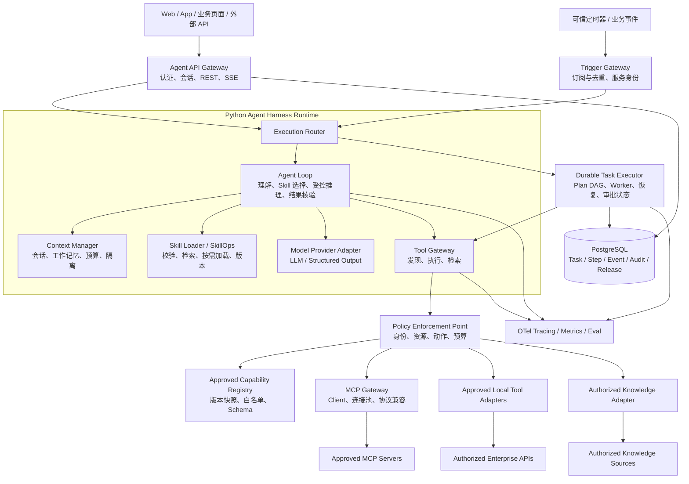
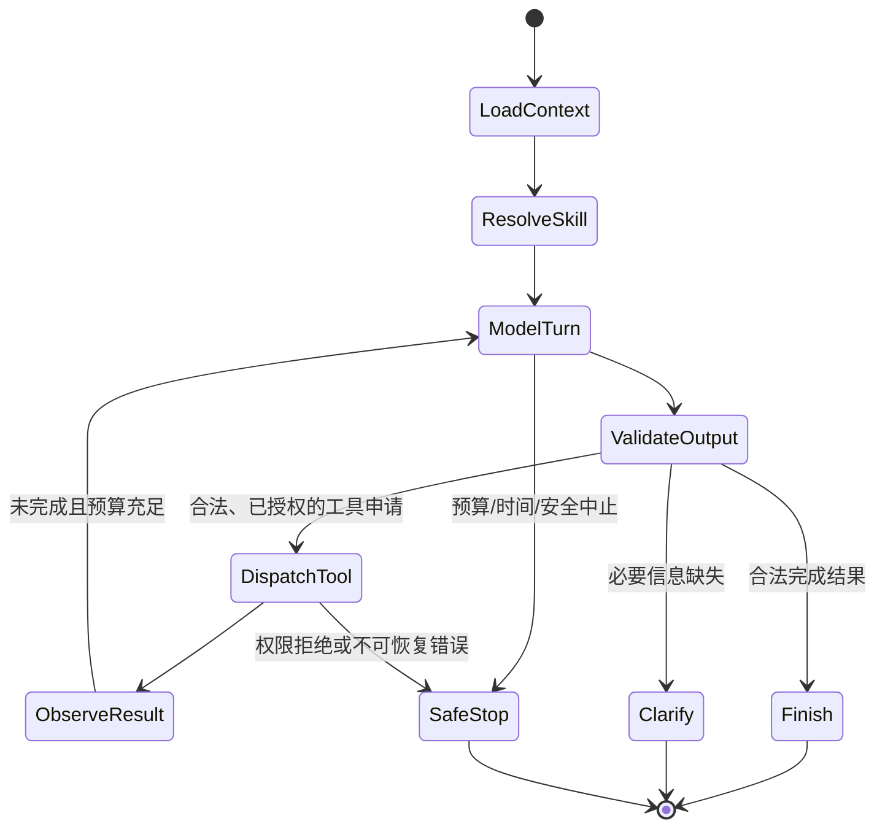

# 企业级通用 Agent Harness V3.0 技术设计与 Codex 开发交接文档

> **版本**：V3.0 — 架构设计与开发交接基线（Design / Implementation Handoff）  
> **编写日期**：2026-11-03  
> **文档状态**：目标设计，非已部署或已验收系统  
> **目标读者**：AI 应用开发工程师、后端工程师、架构师、测试工程师、ChatGPT 桌面版 / Codex  
> **交付目标**：构建不绑定具体业务的、Python 优先的 Agent Harness，能够通过 **Skills + MCP / 受控工具 + 配置化业务域** 接入新业务，具备可靠执行、权限治理、可观测和可回归测试能力。

**范围声明（最高优先级）**：本文**只设计通用底座及其升级路径**；不包含任何特定行业、项目或业务模块的实施计划，不以任何特定现有编排平台作为运行依赖。示例仅使用虚构的通用演示数据。所列 API、数据库表、目录结构、性能目标和配置均为**拟定协议**，必须按实际环境验证后才可声称实现。

---

## 0. 执行摘要与不可变原则

### 0.1 版本定位

| 版本 | 目标 | V3.0 处理方式 |
|---|---|---|
| V1.0 | 通用 Agent、业务注册与工具接入 | 保留可插拔业务与固定入口原则 |
| V2.0 | 持久化任务、计划校验、审批、版本治理、可观测 | 复用已有目标契约；真实实现存在与否须审计 |
| **V3.0** | **独立 Agent Harness、标准 Skill 装载、MCP Gateway、专业能力路由与事件入口** | **增量设计，避免重新实现 V2.0 已有组件** |

V3.0 **不是**：另一个聊天机器人、在提示词里堆积业务规则的“超级 Agent”、直接执行任意 Skill 脚本的自动化机器人，也不是允许模型自行授予权限的通用接口代理。

### 0.2 核心设计决策

1. **单一权威执行状态**：持久化 Task/Step、审批、幂等、恢复由服务端 Task Executor 负责；Harness 只负责受控推理循环、上下文管理、技能选择、计划提议和答案组织。不得产生两套互相矛盾的任务真相。
2. **模型仅提出建议，不作授权裁决**：工具白名单、业务资源范围、敏感字段、动作级权限、预算由可信后端策略决定；每次真实工具调用必须再次鉴权。
3. **Skill 是指令包而非超级权限**：Skill 激活只加载业务方法与受控资源；不能通过 Skill 描述自动扩大工具授权、注入系统指令或执行代码。
4. **MCP 是工具协议而非安全边界**：MCP Server 的发现结果不能直接成为可用能力；必须经过注册、审查、Schema/版本固定与策略过滤。
5. **默认只读**：真实外部写操作默认不可用；高风险动作必须提案、审批、重新授权、幂等执行和结果核验；首轮只实现 Mock 写闭环（可选）。
6. **业务逻辑插件化**：新增业务通过 Business Manifest、Skill 包、Capability 和工具适配器注册；不得修改 `core/` 的业务专用分支。
7. **兼容优先**：如已有 V1/V2 代码，先审计并保留稳定的 `/api/v1/agent/*` 接口与三类逻辑能力（发现 / 执行 / 检索）；仅在必要时新增可选字段、内部服务与管理接口。
8. **可证伪、可验收**：必须区分 Mock、集成、真实环境测试；不得把接口存在、测试代码存在或模型返回 JSON 误写成端到端调用成功。
9. **禁止盲目重构**：任何已有代码、数据模型、接口和授权边界先建立迁移矩阵，再选择复用/包裹/扩展/替换。
10. **不预设具体模型厂商**：模型接入层使用可更换 Provider；生产模型、费用和数据保留策略按企业实际要求选择。

### 0.3 首轮交付边界

**首轮必做**：仓库审计、最小 Harness、Skill Registry 与按需加载、MCP Mock Gateway、只读工具执行、可执行的 REST/SSE、任务审计、两个差异化演示业务、自动化测试。  
**后续阶段**：真实 MCP 互操作、持久化 DAG、事件入口、版本灰度、安全审批、专业 Agent 路由和评测平台。  
**明确不做**：自修改生产代码、自动发布未知 Skills、让模型任意运行命令、跨租户记忆共享、自动批准高风险写入，以及无业务价值的自治 Agent 群。

---

## 1. 总体架构

### 1.1 逻辑架构



**禁止跨层调用**：LLM 不得向外部目标发原始 HTTP 请求；Skill 不得自己携带生产凭据；MCP Server 不得直接决定企业权限；执行引擎不从任意模型文本重建可信身份。

### 1.2 模块职责矩阵

| 组件 | 拥有的职责 | 不允许承担的职责 |
|---|---|---|
| Agent API | 用户认证、会话/Task 创建、SSE、取消与查询 | 直接执行不受控外部写入 |
| Agent Loop | 理解目标、选择技能/工具、产生候选计划、整理结果 | 权限判定、持久化状态真相 |
| Model Adapter | Provider 封装、模型响应规范化、token/成本信息 | 改写业务授权范围 |
| Context Manager | 上下文压缩、摘要、证据引用与工作记忆 | 无权限地跨租户复用信息 |
| Skill Registry/Loader | 技能目录、版本、依赖、按需装载及状态 | 默认执行 Skill 中的脚本 |
| Tool Gateway | 统一 discover / execute / retrieve 入口 | 以模型传入 URL 访问任意服务 |
| MCP Gateway | MCP 连接、协议能力适配、超时/异常包装 | 根据 MCP Server 自报权限直接放行 |
| Policy Engine | 实时权限、资源、动作与预算约束 | 信任用户输入的 tenant_id/user_id |
| Task Executor | 计划校验、DAG、持久化、租约与恢复 | 代替模型进行任意语义推断 |
| Registry Release | 已批准版本、发布快照、吊销、回滚 | 不经审核直接上线新能力 |
| Observability/Eval | 追踪、指标、评测、审计脱敏 | 默认记录用户全部敏感正文 |

### 1.3 两条执行路径

- **`reactive`（短会话）**：API → Agent Loop → Skill 选择 → Gateway 授权工具调用 → 结果核验 → 回复。适合低复杂度、只读、有限工具调用的任务。ToolExecution 仍需审计；不创建多步 DAG。
- **`durable_plan`（复杂任务）**：API → 受限规划 → Plan Schema/DAG/权限/预算校验 → 冻结版本 → Task Executor 调用 Gateway → 存证与恢复 → 模型组织结果。规划阶段不得调用会产生副作用的真实工具。

同一 `task_id` 不得在两条路径间由模型随意切换；模式由服务端策略确定，并在 Task 创建时固定。两种路径共用工具网关和权限引擎，不共享未经核验的模型工作记忆。

---

## 2. 技术选型和抽象原则

### 2.1 推荐第一版技术栈（需经环境审计）

| 层 | 推荐 | 说明 |
|---|---|---|
| 语言 | Python 3.11+ | 使用类型标注与 asyncio；版本以现有环境为准 |
| API | FastAPI + Pydantic v2 | REST、SSE、请求响应验证、OpenAPI |
| Harness | 自有薄编排层 + 可替换的 Agent SDK Adapter | 避免锁定底层执行控制；可评估 OpenAI Agents SDK 作为推理循环实现 |
| 模型 | `ModelProvider` 接口 | 支持真实、企业内模型、确定性 Mock；不硬编码模型名 |
| MCP | 官方 Python MCP SDK 的受支持版本 | 先探测客户端/服务端协议版本与传输兼容性 |
| 数据库 | PostgreSQL | 任务/步骤/版本/审计的权威存储 |
| 异步分发 | PostgreSQL Outbox + Worker（起步）；可选队列 | 队列不作为唯一执行状态来源 |
| ORM/迁移 | SQLAlchemy 2.x + Alembic | DB 约束和状态迁移可回放 |
| 可观测 | OpenTelemetry + 指标采集 | GenAI 语义约定版本需锁定并核验 |
| 测试 | pytest + pytest-asyncio + httpx + schema 校验 | Mock / 集成 / 协议测试分层 |
| 部署 | Docker + 企业配置/密钥管理 | 无凭据入仓库；上线前安全检查 |

不建议起步就写大量自研 Agent SDK 内核；优先实现**独立的领域契约和安全边界**，将具体推理框架封装为 Adapter。是否使用某一框架的循环、Handoff、Tracing 由 P0 阶段 PoC 与兼容评审决定。

### 2.2 必须定义的 Python 抽象

```python
from typing import Protocol, Any

class ModelProvider(Protocol):
    async def generate(self, messages: list[dict], *, tools: list[dict],
                       response_schema: dict | None, budget: dict) -> dict: ...

class SkillRepository(Protocol):
    async def list_allowed(self, run_context: object) -> list[dict]: ...
    async def load(self, skill_id: str, version: str, run_context: object) -> dict: ...

class CapabilityGateway(Protocol):
    async def discover(self, run_context: object) -> list[dict]: ...
    async def execute(self, capability_id: str, arguments: dict,
                      run_context: object, idempotency_key: str) -> dict: ...
    async def retrieve(self, query: dict, run_context: object) -> dict: ...

class PlanProvider(Protocol):
    async def propose(self, goal: str, allowed_capabilities: list[dict],
                      constraints: dict) -> dict: ...

class TaskExecutor(Protocol):
    async def submit(self, task_id: str) -> None: ...
    async def resume(self, task_id: str) -> None: ...
    async def cancel(self, task_id: str) -> None: ...
```

接口为建议抽象，**不是可直接运行的完整实现**；真实代码应使用 Pydantic DTO、异常类型和严格参数类型，不向实现者施加未经验证的 SDK 私有 API。

---

## 3. Agent Harness Runtime 详细设计

### 3.1 Loop 生命周期



**关键钩子（Hooks）**：

- `before_model_call`：检查模型配额、敏感上下文注入策略、可用工具清单。
- `after_model_call`：Schema、停止条件和输出安全校验。
- `before_skill_load`：技能来源、签名/版本、tenant/business 范围、依赖校验。
- `before_tool_execute`：身份、资源、动作、预算、工具输入、审批和幂等检查。
- `after_tool_execute`：Schema、证据、事件、审计和 token/时间账本。
- `before_final_response`：事实证据支持情况、缺口/局限、终态一致性与脱敏。

Hooks 由可信代码安装并按固定顺序执行；模型输出、Skill 文本或工具响应均不得注册、取消或改写安全 Hook。

### 3.2 默认运行预算（仅开发建议值）

| 项目 | 起步配置 | 强制要求 |
|---|---:|---|
| 单次任务模型轮次 `max_model_turns` | 8 | 服务端限制，可按业务降低 |
| 工具调用总数 `max_tool_calls` | 16 | 含失败与重试调用 |
| 单次上下文 token 预算 | 依模型上下文确定 | 不能超过 Provider 的实际上限 |
| 工具并发上限 | 3 | 只读且可并行才允许并发 |
| 单工具超时 | 10s | 按工具白名单配置 |
| 任务总时限 | 90s（交互示例） | 长任务转 `durable_plan` |
| 单次模型规划修复 | 1 次 | 禁止无限自我修复循环 |

这些不是生产 SLO；P0 测试后再定。系统在预算耗尽时必须明确 `BUDGET_EXCEEDED` 并输出可核验的已完成结果，不得假称任务成功。

### 3.3 Context Manager

输入分四类并隔离信任级别：

1. **可信系统配置**：策略、工具白名单、版本快照、业务域约束，只来自后端。
2. **用户输入**：目标、偏好、对象选择；所有对象 ID 仍需校验授权。
3. **Skill 指令**：批准版本的技能说明，不能覆盖系统策略。
4. **不可信外部内容**：工具结果、文件、知识库片段、网页文字，必须作为数据而非执行指令。

实现有限上下文窗口：`recent_turns + task_summary + allowed_skill_instructions + evidence_handles + tool_result_summaries`。压缩摘要不得删除来源引用、数据版本和有效期。跨会话长期记忆初版默认关闭，未来开启必须按租户、用户、业务隔离并提供保留/删除机制。

### 3.4 结构化结果与错误

- 模型生成的 JSON 必须经严格 Schema/枚举/类型校验；不得把解析失败映射为某个看似正常的业务枚举。
- 工具结果以 `tool_execution_id`、`capability_id@version`、`source_ref`、`data_as_of`、`status`、`result_schema_version`、`verified` 留痕。
- 回复至少区分 `answer`、`evidence[]`、`limitations[]`、`unresolved_items[]`，避免将推断包装成事实。
- 不把模型描述的“已调用/已保存/已更新”视为执行证据。

---

## 4. SkillOps：标准 Skill 规范、加载与治理

### 4.1 Skill 与 Capability 的区别

- **Skill**：完成某类任务的方法说明、输入输出规范、引用资料及测试；告诉 Agent **怎样做**。
- **Capability**：实际可调的工具或服务，含访问权限、Schema、适配器、版本和副作用级别；告诉系统 **能做什么**。
- **Business**：业务域与对象范围的组织单元；告诉系统 **在什么范围内做**。

Skill 激活不是权限授予，也不保证其依赖工具可用。必须在真实调用时检查 Capability 白名单、身份和资源。

### 4.2 目录规范

```text
skills/
  record-lookup/
    SKILL.md                    # 标准入口；YAML frontmatter + Markdown
    skill.manifest.yaml         # 本平台扩展元信息，不属于通用标准的必选字段
    references/
      query-guide.md
    schemas/
      input.schema.json
      output.schema.json
    tests/
      positive.json
      negative.json
  report-summary/
    SKILL.md
    skill.manifest.yaml
    references/
    schemas/
    tests/
```

`SKILL.md` 参考 Agent Skills 开放格式，最低要求 `name`、`description`；复杂说明通过 `references/` 延迟加载。附加 `skill.manifest.yaml` 只用于**平台内部治理**，不假定第三方通用 Agent 自动识别它。

**`skills/record-lookup/SKILL.md`：**

```markdown
---
name: record-lookup
description: 在授权范围内查询给定标识的演示记录，并返回可核验的结果。
---

# Record Lookup

## 适用范围
用户明确要求按标识查询，并已提供对象标识。

## 执行步骤
1. 检查必要参数和对象授权。
2. 通过受控 Capability 查询；不要自行构造外部地址。
3. 验证返回 Schema，保留数据版本与来源。
4. 缺失或无权限时明确告知，不猜测记录内容。

## 退出条件
得到已核验的数据，或因参数、权限、超时等原因安全结束。
```

**`skill.manifest.yaml`：**

```yaml
schema_version: "3.0"
skill_id: "record-lookup"
version: "1.0.0"
status: "draft"
business_scopes: ["demo_records"]
required_capabilities:
  - "demo.record.read@1.0.0"
input_schema_ref: "schemas/input.schema.json"
output_schema_ref: "schemas/output.schema.json"
resources:
  - "references/query-guide.md"
execution:
  trust_level: "instructions_only"
  allow_scripts: false
  max_tool_calls: 2
```

以上配置**仅为目标协议**。`status: draft` 不允许生产路由；正式注册需 `validated → staged → active` 发布，任务绑定不可变快照。紧急 `revoked` 无条件覆盖旧任务快照。

### 4.3 技能发现与按需加载

`list_allowed` 只返回少量技能元数据 → 模型或规则路由候选技能 → 后端再过滤授权/依赖/版本 → `load` 获取完整说明 → 必要时单独读取 `references/`。禁止启动时拼接所有技能全文到系统 Prompt。

校验项：名称/描述长度、路径规范化、防目录穿越、签名/哈希、版本号、依赖是否可用、输入输出 Schema、恶意指令扫描、已批准能力的权限级别、同名冲突、失效引用、提示词注入测试。

`Skill` 中的 `scripts/` 即使存在也不自动运行。未来若需要脚本，必须**单独注册为受控能力**，在隔离执行环境、有限文件访问/网络出口和审计下运行；不允许 `exec/eval` Skill 内容。

### 4.4 技能生命周期

`draft → validated → staged → active → deprecated`，异常可转 `revoked`。每次发布记录 `skill_id / version / digest / schema_version / dependency_versions / author / reviewer / evaluation_run_id / release_snapshot_id`。进行中任务继续使用快照版本，但实时权限撤销和能力紧急吊销优先。

---

## 5. MCP Gateway 与工具协议

### 5.1 边界与策略

MCP Gateway 负责**经批准的 MCP Server** 的连接与协议适配，提供稳定的平台内 Capability ID，不把 Server 返回的原始工具名直接暴露给用户或模型。一个 MCP Server 可提供多个工具，但每个生产工具都必须有独立的允许范围和执行策略。

MCP SDK 与协议可能更新；实现时以目标环境的**官方 SDK 兼容矩阵**及服务器实测为准。设计参考 MCP **2026-07-28** 规范，要求显式记录协议版本与支持能力；不得把不同规范版本的会话/初始化假设混为一谈。

### 5.2 MCP 注册记录（示例）

```json
{
  "server_id": "demo_records_server",
  "protocol": "mcp",
  "transport": "streamable_http",
  "endpoint_ref": "approved.servers.demo_records",
  "approved_protocol_versions": ["2026-07-28"],
  "enabled": false,
  "tools": [
    {
      "capability_id": "demo.record.read",
      "version": "1.0.0",
      "remote_tool_name": "find_record",
      "action_level": "read",
      "permission_code": "demo.record.read",
      "input_schema_ref": "schemas/demo.record.read.input.json",
      "output_schema_ref": "schemas/demo.record.read.output.json",
      "timeout_ms": 10000,
      "max_retries": 1
    }
  ]
}
```

`endpoint_ref` 必须在可信配置中映射为静态批准的服务器地址；不能接受 LLM/用户直接传入 URL、命令、可执行路径、Token 或服务端鉴权头。示例 `enabled: false`，完成连接与安全测试才能启用。

### 5.3 网关执行流水线

1. 使用可信 `run_context_id` 解析主体、租户、业务域与任务预算；不接受调用方自报可信身份。
2. 在 Registry 快照中查询 Capability，验证 Server/Tool 处于允许状态与版本兼容。
3. 执行实时权限、业务对象、动作级别、敏感字段、预算、速率和可选审批检查。
4. 严格校验输入 Schema；必要时做参数映射，不允许任意 SQL/URL/命令模板。
5. 通过授权连接池调用 MCP Server；单次请求带 trace/correlation ID、超时与受控取消。
6. 解析 MCP 工具响应，区分协议错误/业务错误/超时/结果未知，校验输出 Schema 和最大大小。
7. 脱敏记录执行证据、持续时间、Server/Tool 版本、错误类别；必要时引用结果存储而不是全量返回大内容。
8. 将结果转成统一 Gateway Envelope，再交给 Harness/Executor。

MCP **resources/prompts** 可以作为受控内容源，但并不自动等同于可执行工具；服务端返回的新工具、URL、描述和提示词均是非可信输入，需要独立审核。`stdio` 仅用于本地已批准子进程或开发测试；生产执行环境默认禁止未知子进程启动。

### 5.4 Gateway 统一结果协议

```json
{
  "tool_execution_id": "te_001",
  "task_id": "task_001",
  "capability_id": "demo.record.read",
  "capability_version": "1.0.0",
  "status": "succeeded",
  "data": {"record_id": "R-1001", "label": "示例数据"},
  "evidence": [
    {"source_ref": "demo://records/R-1001", "data_as_of": "2026-11-03T00:00:00Z"}
  ],
  "error": null
}
```

失败时 `data` 可为 `null`，`status` 为 `failed / outcome_unknown`，`error` 必须包含 `code/message/retryable`；绝不能返回 HTTP 200 + `status=succeeded` 的伪成功。

### 5.5 错误分类与重试

| 类型 | 统一错误码 | 自动重试 |
|---|---|---|
| 未注册工具或版本 | `CAPABILITY_NOT_FOUND` | 否 |
| 权限拒绝 | `PERMISSION_DENIED` | 否 |
| 输入协议非法 | `SCHEMA_VALIDATION_FAILED` | 否 |
| 协议/版本不兼容 | `MCP_PROTOCOL_INCOMPATIBLE` | 否 |
| 上游暂时不可用 | `UPSTREAM_UNAVAILABLE` | 幂等且有界 |
| 只读调用超时 | `TOOL_TIMEOUT` | 按策略、有界 |
| 上游结果不确定 | `OUTCOME_UNKNOWN` | 非幂等操作不得盲重试 |
| 输出不符合 Schema | `TOOL_OUTPUT_INVALID` | 默认否 |
| 调用预算耗尽 | `BUDGET_EXCEEDED` | 否 |
| 技能未批准/失效 | `SKILL_NOT_ACTIVE` | 否 |
| 能力紧急吊销 | `CAPABILITY_REVOKED` | 否 |

安全边界测试必须验证 SSRF、DNS 重绑定、凭据透传、工具名冲突、Schema 欺骗、工具结果提示词注入、并发时的跨租户数据泄露。

---

## 6. 业务接入规范（通用、无业务代码耦合）

### 6.1 Business Manifest

```yaml
schema_version: "3.0"
business_id: "demo_records"
name: "通用记录查询演示"
version: "1.0.0"
status: "draft"
skills:
  - "record-lookup@1.0.0"
capabilities:
  - "demo.record.read@1.0.0"
knowledge_scopes: []
policies:
  default_action_level: "read"
  require_verified_evidence: true
```

业务接入者只可提交声明式 Manifest、Schema 和经审核的工具适配器，不可从 Manifest 注入任意 Python 代码、SQL、URL 或鉴权信息。

### 6.2 标准接入 SOP

1. 定义业务范围与可信对象主键、组织/租户/用户资源权限。
2. 编写 Business Manifest、Skill、Capability Manifest、输入输出 JSON Schema、数据来源说明。
3. 选择已批准的 MCP Server/HTTP 适配器或开发新的受控工具适配器；后端安全审查。
4. 创建正向、缺失参数、非法输入、越权、工具超时、提示词注入和源数据冲突测试。
5. 本地确定性 Mock 跑通；再进行目标服务的真实接口联调，不以 Mock 结果宣称真实联通。
6. 经过 `validate → staged → active` 发布；Task 绑定版本快照，异常时回滚或吊销。
7. **验收：新增第二个业务后 `core/` 无业务特判、无 Core 源码修改**（允许合理通用 Bug 修复，但须单独说明）。

### 6.3 两个差异化演示业务（均为虚构数据）

- **Demo A：记录查询**：给定 `record_id` 查询 Mock 记录，返回来源与时间戳，验证对象级授权及 Skill 激活。
- **Demo B：文档片段归纳**：在授权知识片段中检索并生成有引用的摘要，验证另一类 Skill、Knowledge Adapter 和无 Core 修改接入。

这两个 Demo 不代表真实系统中已存在对应 API。测试必须能在无企业凭据、无真实外部服务的环境运行。

---

## 7. 任务状态、计划与可靠执行（与上一版执行语义兼容）

### 7.1 Task 与 Step

Task 状态：`pending / planning / running / waiting_approval / suspended / completed / partial / failed / cancelled`。终态不可逆，非法状态迁移返回 `409 TASK_STATE_CONFLICT`。

Step 状态：`blocked / ready / leased / running / succeeded / failed / skipped / waiting_approval / outcome_unknown`。成功步骤不得因恢复而再次执行；外部写调用出现不明结果后必须查证，不能盲重试。

### 7.2 受控计划 DSL

```json
{
  "schema_version": "3.0",
  "plan_id": "plan_001",
  "task_id": "task_001",
  "steps": [
    {
      "step_id": "load_record",
      "capability_id": "demo.record.read",
      "depends_on": [],
      "arguments": {"record_id": "R-1001"},
      "required": true
    },
    {
      "step_id": "format_summary",
      "capability_id": "demo.record.summarize",
      "depends_on": ["load_record"],
      "arguments": {
        "record": {"$step_output": "load_record", "path": "/data"}
      },
      "required": true
    }
  ],
  "result_contract": "demo.summary.v1"
}
```

`demo.record.summarize` 为演示的**确定性本地适配器**，须在对应 Demo 的 Registry 中注册；示例 JSON 只是 DSL 样本，不代表已实现。

Plan Validator 必须拒绝：重复 step_id、悬空依赖、循环依赖、未授权 Capability、非法对象引用、任意表达式、超预算计划、非法 Schema、未经审批的写操作。`$step_output` 仅支持白名单 JSON Pointer、引用已完成且依赖关系可达的前驱结果，不支持模板执行或脚本求值。

### 7.3 持久化恢复规则

- Task/Step/Execution/Event 的状态变更采用数据库事务；消息发布建议使用 Outbox。
- Worker 使用租约、过期时间与 fencing token，竞争同一步骤时只能一个工作者提交成功结果。
- `succeeded` 步骤重启不重复执行；`running` 过期租约通过状态校验后再恢复。
- `waiting_approval` 不占用 Worker；审批后由可信事件恢复。
- 取消只阻止后续调度，不宣称撤销已生效的外部操作。
- `release_snapshot_id` 固定业务/Skill/Capability 版本；实时权限撤销、紧急禁用仍可中止进行中任务。

### 7.4 事件入口

提供 `Trigger Gateway` 抽象，接受可信的定时/事件来源，要求：签名/服务认证、`event_id` 去重、来源与数据范围校验、过期事件处理、并发限流和回放保护。默认不开启任意外部事件订阅；首轮以本地 Mock 触发器证明事件可转化为 Task，后续才接真实事件系统。

---

## 8. REST API、SSE 与前后端契约

### 8.1 版本策略与鉴权

默认保留 `/api/v1/agent/*` 路径以兼容旧客户端；V3 的增强通过可选字段或新管理 API 扩展，不强制整体换前缀。所有业务请求使用 `Authorization: Bearer <trusted_token>`；`tenant_id / org_id / user_id` 由可信认证上下文推导，不允许客户端任意自报。管理接口与普通业务接口使用不同权限域。

**对外 API 建议：**

| 方法 | URI | 作用 | 前端职责 | 后端职责 |
|---|---|---|---|---|
| POST | `/api/v1/agent/sessions` | 创建会话 | 传业务域和可选上下文 | 鉴权、会话绑定、返回 ID |
| POST | `/api/v1/agent/chat` | 提交用户任务 | 发送消息/模式/对象引用 | 创建 Task、调度、返回结果或 SSE |
| GET | `/api/v1/agent/tasks/{task_id}` | 查询 Task 状态和摘要 | 轮询/恢复 UI | 权限校验、只返回授权字段 |
| GET | `/api/v1/agent/tasks/{task_id}/events` | SSE 事件流 | `Last-Event-ID` 断线重连 | 事件重放与增量推送 |
| POST | `/api/v1/agent/tasks/{task_id}/cancel` | 申请取消 | 提示取消边界 | 终止后续调度并记录结果 |
| GET | `/api/v1/agent/skills` | 获取当前用户可用技能摘要 | 展示可用能力（可选） | 按权限与已发布版本过滤 |
| GET | `/api/v1/agent/capabilities` | 查询当前范围可用能力 | 仅用于展示 | 按服务端策略过滤 |
| POST | `/api/v1/agent/tasks/{task_id}/approve` | 任务审批（后续阶段） | 操作有权审批的请求 | 校验审批人/摘要/有效期/幂等 |
| POST | `/api/v1/agent-admin/releases/validate` | 管理面校验发布包 | 管理后台使用 | 校验签名、Schema、依赖和安全 |
| POST | `/api/v1/agent-admin/releases` | 发布新版本 | 管理后台使用 | 登记 Release Snapshot |

**内部 Gateway 逻辑入口**（实现可为进程内调用或可信内网 API）：`discover_capabilities`、`execute_capability`、`retrieve_knowledge`。若采用内网 HTTP，建议 `POST /internal/agent/discover`、`/internal/agent/execute`、`/internal/agent/retrieve`；强制服务到服务鉴权、独立权限与审计，禁止作为公网开放工具接口。

### 8.2 提交请求示例

```http
POST /api/v1/agent/chat HTTP/1.1
Authorization: Bearer <trusted_token>
Idempotency-Key: demo-request-001
Content-Type: application/json
```

```json
{
  "business_id": "demo_records",
  "session_id": "ses_001",
  "message": "查询记录 R-1001 并给出来源",
  "execution_mode": "reactive",
  "response_mode": "streaming",
  "context": {
    "object_type": "demo_record",
    "object_ids": ["R-1001"]
  }
}
```

**创建成功（示例）**：

```json
{
  "request_id": "req_001",
  "task_id": "task_001",
  "session_id": "ses_001",
  "status": "pending",
  "execution_mode": "reactive",
  "events_url": "/api/v1/agent/tasks/task_001/events"
}
```

`POST /chat` 在异步流式模式建议返回 `202 Accepted` 和上述 Task 句柄；历史客户端若采用直接 SSE，应保留兼容适配层，不以此示例擅自改变既有行为。

**终态响应示例**：

```json
{
  "request_id": "req_001",
  "task_id": "task_001",
  "status": "completed",
  "answer": "已找到授权记录。",
  "evidence": [{"source_ref": "demo://records/R-1001"}],
  "limitations": [],
  "failed_steps": [],
  "error": null
}
```

### 8.3 SSE 约定

事件使用标准 SSE：`id`、`event`、`data`，`data` 为 JSON 字符串。事件最少支持：`task_started`、`skill_selected`、`tool_started`、`tool_result`、`message_delta`、`task_completed`、`task_partial`、`task_failed`、`task_cancelled`；复杂模式扩展 `step_started`、`step_completed`、`approval_requested`、`task_suspended`、`task_resumed`。

```text
id: 12
event: tool_result
data: {"task_id":"task_001","seq":12,"event_type":"tool_result","occurred_at":"2026-11-03T00:00:10Z","payload":{"capability_id":"demo.record.read","status":"succeeded"}}

```

- `seq` 单调递增、事件可重放；同一 Task 只能有一个终态事件。
- `Last-Event-ID` 断线重连不应再次执行工具，只重放持久化事件。
- SSE 默认不发送敏感原始文档、访问凭据、内网地址或工具完整秘密参数。
- SSE 断线不等于任务取消；取消必须显式调用 Cancel API。

### 8.4 错误响应规范

```json
{
  "request_id": "req_001",
  "error": {
    "code": "PERMISSION_DENIED",
    "message": "当前操作不在授权范围内",
    "retryable": false,
    "details": {}
  }
}
```

建议 HTTP 映射：`400` 参数错误，`401` 未认证，`403` 权限拒绝，`404` 不可见资源，`409` Task 冲突/幂等冲突，`422` 严格 Schema 错误，`429` 限流/预算，`502` 上游协议异常，`503` 暂时不可用，`504` 超时。内部错误不能原样暴露第三方凭据或完整堆栈。

---

## 9. 数据模型与存储建议

### 9.1 关键实体

| 实体 | 核心字段 | 不变约束 |
|---|---|---|
| `agent_sessions` | id, tenant_id, user_id, business_id, created_at | 会话归属不可变 |
| `agent_tasks` | id, session_id, status, mode, release_snapshot_id, budget_json, version, request_hash | 唯一状态真相、乐观锁 |
| `agent_plans` | id, task_id, revision, schema_version, digest, plan_json | 修订不可原地覆盖 |
| `agent_steps` | id, task_id, step_id, status, capability_id/version, lease_owner, fencing_token | `(task_id, step_id)` 唯一 |
| `tool_executions` | id, task_id, step_id, capability_id, attempt, idempotency_key, status, evidence_refs | 每次调用可审计 |
| `agent_events` | id, task_id, seq, type, payload_safe_json, occurred_at | `(task_id, seq)` 唯一 |
| `registry_releases` | id, digest, manifest_versions, status, created_at | 运行时引用不可变 |
| `skill_releases` | skill_id, version, digest, status, approved_at | 技能版本可追溯 |
| `mcp_servers` | server_id, endpoint_ref, allowed_versions, status | 不保存明文 Token |
| `approval_requests` | id, task_id, step_id, payload_digest, approver_rule, status, expiry | 审批不可重放 |
| `audit_events` | id, actor_id, action, object_ref, decision, correlation_id | 敏感内容脱敏 |
| `eval_runs` | id, suite_id, release_id, model_id, result_summary | 发布门禁可复核 |

### 9.2 最小数据库约束

- `agent_tasks.version` 使用 CAS 乐观锁；唯一幂等范围为 `(tenant_id, actor_id, endpoint_scope, idempotency_key)` 并比较请求摘要。
- `agent_events` 按 `(task_id, seq)` 唯一，终态通过 Task 行锁/唯一约束防重复发布。
- `agent_steps` `(task_id, step_id)` 唯一，租约领取使用 `FOR UPDATE SKIP LOCKED` 或同等原子锁策略。
- `tool_executions` 保存必要审计字段；对上游幂等键及执行状态做索引。
- `registry_releases.digest` 保证内容可验证，运行中 Task 固定 `release_snapshot_id`。
- 全部表的授权查询要以可信租户和资源范围过滤；仅 `WHERE task_id=...` 不足以形成租户安全。
- 秘钥仅引用 Secrets Manager 句柄；日志和数据库中不保存完整 Token、原始高敏提示词或跨租户检索内容。

### 9.3 可靠性

生产建议 PostgreSQL 作为 Task/Step/审批/审计权威存储，配合 Outbox 或等价可靠消息策略；Worker 重启与并发执行必须能恢复。开发环境可用 SQLite+单 Worker，但不得据此宣称已满足并发生产能力。

---

## 10. 安全治理与威胁模型

### 10.1 核心威胁与防线

| 威胁 | 典型攻击入口 | 必须的控制 |
|---|---|---|
| Prompt Injection | Skill 文本、知识片段、工具返回 | 信任分层，不可信内容不得变更工具权限和策略 |
| Confused Deputy | 模型借用有权用户执行他人资源请求 | 对每次工具调用校验主体与对象权限 |
| SSRF / 任意网络访问 | 模型请求参数中包含外部 URL | 固定 endpoint_ref + DNS/出口限制 |
| 命令执行 | Skill 脚本或不受控子进程 | 生产默认禁止；脚本独立审批与隔离沙盒 |
| 数据串租户 | 历史会话、缓存、知识结果 | 租户键、对象级过滤、测试和日志脱敏 |
| 工具重放 | 请求重试、断线恢复 | 幂等键、事件重放与执行记录分离 |
| 供应链风险 | 第三方 MCP Server、Skill 包 | 来源校验、版本固定、完整性摘要、漏洞审查 |
| 非法发布 | 模型或普通用户修改 Registry | 发布/审批管理面独立鉴权 |
| 状态漂移 | Worker 并发、重复消息 | 租约、fencing token、事务与状态 CAS |
| 数据过期/伪造 | 证据引用缺时间/来源 | Evidence Envelope 与失效核查 |

### 10.2 写操作策略

动作分级：`read`、`propose_write`、`commit_write`。默认只开放 `read`，`propose_write` 必须保证不产生正式业务副作用；`commit_write` 默认拒绝。

未来若开放写入：**提案 → 审批 → 重新校验身份/资源/版本 → 幂等提交 → 查询验证**。用户一句“可以”不是可复用的正式审批凭据；审批只对固定 payload digest、对象集合、能力版本、有效期和实际有权审批人有效。写超时未知结果必须先查证，绝不能盲目重试。

### 10.3 数据与模型治理

- 提供按环境配置的模型数据保留与脱敏策略；不默认将完整工具结果发送到外部模型。
- 生产模型调用必须按企业安全规定处理敏感文档、个人数据、跨组织授权。
- 不信任任何模型自称的“已执行”状态；以服务端工具执行记录和真实返回值为准。
- 操作审计仅由服务端写入，无法被 Prompt、Skill 或工具结果删除。

---

## 11. 可观测性、评测与质量标准

### 11.1 全链路观测

关联字段：`request_id / trace_id / session_id / task_id / step_id / skill_id@version / capability_id@version / model_provider / tool_execution_id / release_snapshot_id`。Span 至少覆盖请求、Skill 发现与加载、模型推理、工具调用、计划验证、执行步骤、恢复和结果组织。

建议监控：成功/部分成功/失败率、拒绝率、调用时延 p50/p95、MCP 连接/超时/Schema 错误、模型 token 与成本、每任务工具次数、取消成功率、Step 重试数、任务恢复时间、事件延迟、评测通过率、证据可追溯率。

OpenTelemetry 的 GenAI 语义约定仍可能演进；实现时固定依赖版本，在仪表盘建立向后兼容映射。默认上报摘要/哈希，不发送敏感明文。

### 11.2 评测分层

- **Unit**：Schema、DAG、Skill 解析、权限规则、状态迁移、预算、结果标准化。
- **Contract**：MCP/HTTP 工具协议、版本协商、SSE、字段/错误码、兼容性。
- **Integration**：API → Harness → Gateway → Mock Server / 真实受控测试 Server。
- **Adversarial**：提示词注入、越权、伪造身份、工具描述欺骗、数据污染、目录穿越。
- **Resilience**：超时、取消、重复事件、Worker 崩溃、连接断开、恢复和幂等。
- **Regression**：固定样本集对照旧版；新增 Skill 不改变已有业务结果。

### 11.3 建议验收阈值（候选，非已达成）

1. P1 本地固定测试集通过率 **100%**；越权/跨租户用例应 **0 放行**。
2. 新增第二个 Demo：`core/` **0 个业务专用代码变更**。
3. HTTP/SSE 协议用例（重放、取消、唯一终态）全部通过。
4. MCP 工具输入/输出 Schema 校验与白名单拦截全部通过。
5. 两 Worker 故障恢复测试中，成功 Step 无重复提交；不明写结果不会自动重试。
6. 真实互操作必须使用**实际 MCP Server** 的日志、版本和调用结果证明，不得用 Mock 替代。
7. 生产 p95 与成本目标在实际负载基准测量后确认，不能在设计阶段假设。

---

## 12. 推荐代码目录（新建仓库时）

```text
enterprise-agent-harness/
├── README.md
├── pyproject.toml
├── uv.lock                     # 若采用 uv，须锁定依赖
├── .env.example                # 仅占位符
├── docker-compose.yml
├── alembic.ini
├── migrations/
├── app/
│   ├── main.py
│   ├── api/
│   │   ├── sessions.py
│   │   ├── chat.py
│   │   ├── tasks.py
│   │   ├── events.py
│   │   └── admin_releases.py
│   ├── harness/
│   │   ├── agent_loop.py
│   │   ├── model_provider.py
│   │   ├── context_manager.py
│   │   ├── skill_router.py
│   │   ├── hooks.py
│   │   └── result_validator.py
│   ├── skills/
│   │   ├── registry.py
│   │   ├── loader.py
│   │   ├── validator.py
│   │   └── release_service.py
│   ├── tools/
│   │   ├── gateway.py
│   │   ├── policy.py
│   │   ├── capability_registry.py
│   │   ├── mcp_client.py
│   │   ├── mcp_adapter.py
│   │   ├── local_adapter.py
│   │   └── knowledge_adapter.py
│   ├── execution/
│   │   ├── task_service.py
│   │   ├── plan_validator.py
│   │   ├── durable_executor.py
│   │   ├── worker.py
│   │   └── event_outbox.py
│   ├── security/
│   │   ├── auth.py
│   │   ├── policy_engine.py
│   │   └── audit.py
│   ├── storage/
│   │   ├── models.py
│   │   ├── repositories.py
│   │   └── migrations_support.py
│   └── observability/
│       ├── tracing.py
│       ├── metrics.py
│       └── evaluation.py
├── manifests/
│   ├── businesses/
│   └── capabilities/
├── skills/
│   ├── record-lookup/
│   └── report-summary/
├── examples/
│   ├── mock_servers/
│   ├── demo_a/
│   ├── demo_b/
│   └── requests.http
├── tests/
│   ├── unit/
│   ├── contract/
│   ├── integration/
│   ├── security/
│   ├── resilience/
│   └── regression/
└── docs/
    ├── architecture.md
    ├── api-contract.md
    ├── skill-authoring.md
    ├── mcp-integration.md
    ├── threat-model.md
    ├── runbook.md
    └── migration-matrix.md
```

已有仓库不应机械套用新目录；先映射职责再最小改动。`mcp_client.py` 为隔离 SDK 的包装层，不应让业务模块依赖第三方 SDK 私有对象。`skills/` 是受控资源目录，与 `app/skills/` 管理代码分开。

---

## 13. 研发分工与系统集成边界

| 工作项 | Agent 开发 | 后端 BE | 前端 FE | 测试/安全 |
|---|---|---|---|---|
| Harness Loop / Model Adapter | 负责 | 部署集成 | 无 | 模型/回归测试 |
| Skill Loader / MCP Gateway | 负责 | 密钥、网络和权限服务 | 能力显示 | 工具协议与安全测试 |
| Task/Step 状态与持久化 | 设计协作 | 主要负责或共同实现 | 任务状态展示 | 故障恢复测试 |
| Auth/RBAC/租户/审计 | 提供挂钩 | **权威负责** | 仅传用户凭证 | 越权与审计测试 |
| REST/SSE | 定义协议 | 接口实现/集成 | 断线恢复、取消、审批 UI | 契约测试 |
| Registry 发布与回滚 | Schema/验证器 | 发布平台/CI/运维 | 管理端可选 | 发布门禁与回滚演练 |

**前后端集成验收**：必须附路径、HTTP 方法、请求/响应 JSON、错误码、鉴权要求、SSE 样例、前端展示状态以及责任归属。不能仅用“Agent 已能回答”作为集成完成依据。

---

## 14. 分阶段实施计划（不跳阶段）

### V3-P0：环境与历史实现审计（首轮必做）

**实施：** 读取实际仓库、依赖、既有 REST/SSE、DB、权限与部署方式，列出复用与冲突；验证 Python、模型 Provider、MCP SDK 及现有执行器的兼容性；选择自有薄 Harness 或已验证 Agent SDK Adapter 的 PoC。  
**交付：** `docs/p0-environment-audit.md`、`docs/migration-matrix.md`、架构决策记录 ADR、风险清单、可运行环境检查命令。  
**门槛：** 明确哪些模块已实现、仅设计、Mock、需重构；不得猜测外部系统状态。

### V3-P1：最小独立 Harness 与双 Demo（首轮必做）

**实施：** `ModelProvider` Mock + Agent Loop + Skill 目录/校验/按需加载 + Capability Registry + Policy Hook + Mock Tool Adapter + REST/SSE + Demo A/B；两业务均可端到端执行。  
**交付：** 项目代码、`.env.example`、启动说明、请求示例、真实执行的自动化测试结果。  
**门槛：** 新增 Demo B 不改 Core；无真实凭据也能运行；明确标注 Mock；至少涵盖正常、非法输入、越权、错误、超时、SSE 与预算测试。

### V3-P2：标准 MCP Gateway 互操作

**实施：** 基于实际 SDK 的 MCP Client、注册白名单、版本协商、协议错误映射、授权连接与超时、真实测试 Server、工具输出校验；禁止任意 Server 动态准入。  
**交付：** MCP 互操作报告、Server/Tool 版本清单、追踪记录、越权/注入安全测试。  
**门槛：** 真实工具调用链路可验证；故障不泄露凭据；Mock 与真实结果分别统计。

### V3-P3：可靠执行与主动入口

**实施：** 复用或完善 Task Executor、Plan Validator、PostgreSQL、Outbox、Step 租约恢复、定时/事件触发、幂等；若上一版已实现则只做契约适配与回归。  
**交付：** 数据迁移、Worker 恢复与并发测试、计划失败分类报告。  
**门槛：** 重启/重复投递无重复成功提交，取消、部分成功、预算限制和唯一终态行为符合协议。

### V3-P4：SkillOps、版本发布、可观测与治理

**实施：** Skill/Capability Release、校验/灰度/回滚/吊销、OTel、发布评测、审计脱敏、权限管理；真实写操作仍默认关闭。  
**交付：** 发布 SOP、观测仪表指标清单、评测集、回滚演练、权限报告。  
**门槛：** 进行中任务版本固定，权限/吊销实时生效，发布不导致已有业务回归。

### V3-P5：专业 Agent 路由（可选增强）

**实施：** 对独立专业能力增加 Agent Adapter、受控 Handoff、统一 Task/权限与证据交接。  
**交付：** 两个小型专业 Agent 的 Mock/集成样例。  
**门槛：** 无跨 Agent 权限扩张、无无限委派环、总预算受上层限制；必要时可关闭本能力而不影响单 Agent 主流程。

**执行纪律**：除非用户另行指定，Codex 第一轮仅实施 **P0 + P1**；P2~P5 先作为设计与待办，不做未经验证的真实系统接入和生产改动。

---

## 15. 验收用例清单（建议最低基线）

> 这些是**待实现的测试标准**，不是已执行结果。每个用例需记录实际命令、测试数据、期望、实测、日志/Trace 链接及 Mock/Integration/Real 标签。

| ID | 类型 | 用例 | 预期 |
|---|---|---|---|
| T01 | Skill | 仅加载获批 Skill 元数据 | 不加载未批准正文 |
| T02 | Skill | 激活单个 Skill | 只加载必要说明和引用 |
| T03 | Skill | Skill 依赖工具缺失 | 明确依赖错误 |
| T04 | Skill | Skill 路径包含 `../` | 拒绝目录穿越 |
| T05 | Skill | Skill 文件含未经批准脚本 | 不执行 |
| T06 | Skill | Skill 已被吊销 | 即时拒绝新工具调用 |
| T07 | Registry | 新业务加入而不修改 Core | 两业务端到端通过 |
| T08 | Registry | 能力版本发生不兼容修改 | 发布校验失败 |
| T09 | Registry | 任务固定旧版、同时发布新版 | 旧任务不静默漂移 |
| T10 | MCP | 未注册 Server | 拒绝连接 |
| T11 | MCP | Protocol 不兼容 | 明确返回兼容性错误 |
| T12 | MCP | 工具不存在或名称冲突 | 拒绝执行 |
| T13 | MCP | 工具输入 Schema 错误 | 422 / 标准错误 |
| T14 | MCP | 工具输出 Schema 错误 | 不标记 succeeded |
| T15 | MCP | 上游超时 | 有界重试与明确结果 |
| T16 | MCP | 工具说明提示词注入 | 不改变授权与 Hook |
| T17 | Auth | 伪造 tenant_id/user_id | 不被采用 |
| T18 | Auth | 跨租户资源查询 | 拒绝且无数据泄露 |
| T19 | Auth | 任务进行中撤销权限 | 后续调用被拒绝 |
| T20 | Budget | 工具/模型调用超限 | 安全停止，输出明确原因 |
| T21 | Model | 模型输出损坏 JSON | 分类为技术错误 |
| T22 | Model | 模型虚构工具调用成功 | 无执行证据不得判成功 |
| T23 | Task | DAG 包含环 | 校验失败 |
| T24 | Task | `step_output` 引用越权路径 | 拒绝 |
| T25 | Task | 断线重新连接 SSE | 仅重放事件，不重复执行工具 |
| T26 | Task | 同一任务重复终态事件 | 存储约束阻止 |
| T27 | Task | 两 Worker 同时领取 Step | 仅一个持有有效租约 |
| T28 | Task | Worker 重启恢复 | 已成功步骤不重复提交 |
| T29 | Task | 取消任务时已有结果 | 不虚构回滚，终态一致 |
| T30 | Security | 尝试任意 URL / SSRF | 可信端点白名单拦截 |
| T31 | Security | 工具结果含敏感 Token | 日志/SSE 脱敏 |
| T32 | Security | 未批准 `commit_write` | 默认拒绝 |
| T33 | Evidence | 无来源的结论 | 标明证据不足 |
| T34 | Knowledge | 跨业务知识片段混入 | 权限过滤且回归通过 |
| T35 | Compat | 旧 `/api/v1/agent/*` 客户端 | 约定字段不破坏 |
| T36 | Trigger | 重复事件 ID | 仅创建一次受控任务 |
| T37 | Observability | trace 和 task/skill/tool 关联 | 可复核且无敏感明文 |
| T38 | Resilience | 上游结果未知（模拟写操作） | 禁止盲目重试 |
| T39 | Release | `revoked` 能力被旧任务调用 | 实时拒绝 |
| T40 | Eval | 固定评测样本运行两版 | 结果可重复且有比较报告 |

---

## 16. Codex 开发交接指令（可直接复制）

> 将本章完整交给 ChatGPT 桌面版 / Codex，并提供实际仓库目录。如无仓库则按本文的新仓库结构初始化。**当前仅授权实施 P0 与 P1。**

```text
你现在是“企业级通用 Agent Harness V3.0”项目的架构师、Python 后端开发工程师和测试负责人。

唯一目标规格：《企业级通用 Agent Harness V3.0 技术设计与 Codex 开发交接文档》。
本轮只开发通用底座，不引入任何具体行业业务模块、特定现有编排平台，也不访问或改写生产业务系统。

一、先分析
1. 完整读取本文；清点当前仓库、Python/包管理器、API、数据库、权限、部署和测试现状。
2. 建立“已存在/仅设计/需新增/需适配/不可更改”矩阵，核验是否已有任务执行器、Registry 或 Gateway；禁止重复造一套持久化状态机。
3. 核验 MCP 官方 Python SDK 与目标环境兼容性，不能凭旧示例编写未经验证的协议握手、初始化或任务机制。
4. 给出 P0 审计报告和 P1 最小实施清单，不擅自更改稳定对外接口或已有权限边界。

二、实施 P1
1. 实现独立 Python Harness：ModelProvider Mock、Agent Loop、生命周期 Hooks、Context Manager 与严格结构化输出校验。
2. 实现 Skill Registry/Loader：SKILL.md 规范、内部 Manifest、按需加载、版本/状态/依赖校验、路径隔离、默认禁止执行脚本。
3. 实现 Capability Registry 与三个逻辑入口：discover_capabilities、execute_capability、retrieve_knowledge。
4. 实现 Mock Tool Adapter、Policy Enforcement、业务对象权限验证、执行预算、统一错误和工具调用审计。
5. 实现 HTTP REST / SSE：创建/查询会话与任务，任务提交、流式状态、事件重放、取消；不泄露凭据。
6. 提供 Demo A（授权记录查询）和 Demo B（授权片段归纳）两个完全虚构的业务，验证新增业务不修改 Core。
7. 提供 README、.env.example、依赖锁、示例 HTTP、自动化测试、最小部署或启动命令。
8. 无真实模型凭据时用确定性 Mock，不能将 Mock 模型推理和真实模型调用混淆。

三、验收与提交
1. 实际运行类型检查、单测、接口/安全测试、两 Demo E2E；逐条报告执行命令、用例数、通过/失败及失败原因。
2. 特别验证 T01~T07、T13~T22、T25、T30~T35；其余 P2+ 用例先建待办、不要谎称通过。
3. 若有现有仓库，输出精确的 Git Diff、影响文件、兼容性、风险、回滚方法。
4. 绝不提交真实密钥、Token、内网私密地址、企业合同或生产用户数据。
5. 不删改任何现有稳定业务接口和授权边界；不默认开放外部写操作。
6. P0/P1 之外的真实 MCP 接入、生产任务恢复、发布平台和多 Agent 仅提交设计与待办。完成本阶段后停止，等待确认。

四、最终交付格式
- 环境/差异审计报告
- 源码目录与核心模块职责
- REST、SSE、Schema 和错误码对照
- 运行方式与示例请求/响应
- 已执行的测试报告（注明 Mock/Integration/Real）
- 已知问题和限制
- 下阶段 P2 工作拆解及依赖
```

---

## 17. 验收 Definition of Done（明确何时可称“完成”）

1. **P0 完成**：有可信的代码与环境清单、冲突矩阵、技术选型评审与实际运行证据。
2. **P1 完成**：本地启动命令实际成功、两个 Demo 分别端到端执行、Mock 标签清晰；Skill 动态加载与 Tool Gateway 可用。
3. **通用性通过**：第二业务接入无业务分支写进 Core；所有工具访问都经统一策略与 Schema 校验。
4. **权限通过**：越权和跨租户测试全数拦截；无模型直连任意 URL、无生产凭据泄露。
5. **协议通过**：REST/SSE/错误码和 API 文件一致，断线重连不重复执行工具，前端能识别所有 Task 状态。
6. **真实集成通过（P2+）**：给出真实 MCP Server 信息、协商版本、调用 ID、日志与故障测试，非 Mock 替代品。
7. **可靠运行通过（P3+）**：并发 Worker、持久化恢复、租约、幂等、取消和不明结果处理均有实测记录。
8. **发布治理通过（P4+）**：审批过的 Skill/Capability 可以灰度、回滚、吊销，历史任务版本与实时安全策略一致。
9. **可交接**：有源代码、依赖锁、运行文档、测试结果、风险列表、回滚办法；不靠口头解释或聊天上下文才能复现。

---

## 18. 设计参考与版本核验

> 下列是规范/官方技术参考，不代表自动采用其全部功能。开发时记录查询日期、实际包版本及兼容性验证结果。

1. **Model Context Protocol 官方规范（2026-07-28）**：https://modelcontextprotocol.io/specification/2026-07-28 ；发布说明：https://blog.modelcontextprotocol.io/posts/2026-07-28/ 。实现应明确协议能力协商与版本兼容。
2. **MCP Python SDK**：https://py.sdk.modelcontextprotocol.io/ ；需按项目实际依赖锁和目标 Server 验证。
3. **Agent Skills 规范**：https://agentskills.io/specification ；`SKILL.md`、YAML frontmatter、按需加载及资源目录。
4. **OpenAI Agents SDK Python（可选推理循环 Adapter）**：https://openai.github.io/openai-agents-python/ ；框架能力需以实际 SDK 版本为准，不得取代服务端权限和任务状态真相。
5. **OpenTelemetry GenAI 语义约定**：https://opentelemetry.io/docs/specs/semconv/gen-ai/ ；该领域仍演进，依赖需固定版本。
6. **FastAPI**：https://fastapi.tiangolo.com/ ；**Pydantic**：https://docs.pydantic.dev/ 。

---

## 19. 最终架构判断

V3.0 应当是一个**有明确执行与权限边界的 Agent Runtime 产品**，而非独立业务应用：

- **Harness** 让模型能理解目标、发现并加载专业 Skill、按预算选择工具。
- **SkillOps** 让能力有标准格式、依赖、版本、测试与发布治理。
- **MCP Gateway** 让外部工具可标准化接入，但调用仍由企业策略裁决。
- **Durable Executor** 让复杂任务可恢复、可审计，不以模型文字记忆代替状态管理。
- **统一 API / SSE / Registry** 让新业务接入时不需要重新搭一套 Agent 内核。

**最重要的验收证明不是架构图，而是：在不修改 Agent Core 的条件下，加入两个差异化 Demo，完成真实运行的权限、Schema、SSE 与工具调用测试。**
