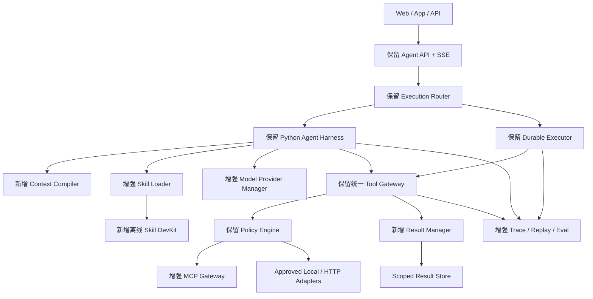

# 企业级通用 Agent Harness V3.1 技术升级设计与 Codex 增量开发交接文档

> 版本：V3.1（V3.0 增量设计规格，非独立工程）  
> 日期：2026-11-03  
> 状态：目标设计与开发交接，**不代表已经实现、测试通过或部署**  
> 唯一主架构基线：《企业级通用 Agent Harness V3.0 技术设计与 Codex 开发交接文档》  
> 历史参考：V1.0 / V2.0 设计文档，只用于继承契约和理解架构来源  
> 范围：纯 Python 通用底座；不绑定第三方编排平台；不包含任何具体行业业务实施方案  
> 使用方式：与 V3.0 一同交给 ChatGPT 桌面版 / Codex，实际仓库中的**已实现事实**须优先审计验证。

---

## 0. 执行摘要与不可变约束

### 0.1 版本定位

**V3.0** 构建 Python Agent Harness + Skill Loader + MCP Gateway + Tool Gateway + Durable Executor + Policy Engine。**V3.1** 在同一底座上补强上下文效率、Skill 开发体验、MCP 互操作、模型能力匹配、工具结果治理、安全测试和可复现回放。

V3.1 不是第二套 Agent Core；V3.1 不因版本增加而替换 V3.0 任务执行器、权限系统或外部接口。

### 0.2 十条不可变约束

1. **唯一 Agent Core、唯一 Tool Gateway、唯一权威 Task/Step 数据存储和 Durable Executor**；不建立两套运行状态真相。
2. 保留 V3.0 的 `reactive` 与 `durable_plan` 两条执行模式，模式在 Task 创建时由可信策略固定。
3. 保留 `/api/v1/agent/*` 的请求/响应兼容性、既有 SSE `id/event/data/seq` 语义、错误码与状态字段；增强仅通过可选字段、内部组件或单独的新接口完成。
4. 内部三入口 `discover_capabilities`、`execute_capability`、`retrieve_knowledge` 保持逻辑兼容；所有真正工具调用进入同一个受控 Gateway。
5. Skill、MCP 远端描述和模型输出不是授权凭证；身份、租户、组织、对象、动作、预算由可信后端实时裁决。
6. 默认只读；真实写入继续遵守已设计的提案、审批、重新鉴权、幂等、查证机制，不在本版本开放新的真实写能力。
7. Skill 包和工具返回均作为不可信输入；不执行模型生成 shell/SQL/URL，不允许 Skill 直接执行脚本或获得额外工具权限。
8. 全面保留版本快照与紧急吊销语义；正常任务固定 Skill/Capability/Schema/配置版本，权限撤销和安全吊销即时覆盖快照。
9. 真实环境、协议集成和 Mock 测试分别报告；未执行测试为 `NOT_RUN`，不能凭测试用例存在宣称通过。
10. **先分析、再逐项开发、逐项验证**；未经批准不重构已有业务、删字段、改数据库权威结构、替换生产配置或访问真实业务数据。

### 0.3 版本实施事实边界

V1/V2/V3 现有设计不能证明仓库中已有对应代码。若仓库没有 V3.0，先依 V3.0 建立**单一**可运行最小基线，再把 V3.1 增量纳入同一工程。若仓库已有部分实现，则通过 Adapter/原位增强复用，不为 V3.1 新建平行系统。V3.1 的全部代码、API、性能指标在未验证前均视为目标规格。

---

## 1. V1 → V2 → V3 → V3.1 架构继承与迁移矩阵

| 能力 | 来源 | V3.0 归属 | V3.1 处理 | 迁移要求 |
|---|---|---|---|---|
| REST API / Session / SSE | V1 | Agent API | **保持不变** | 原路由、字段、HTTP 语义回归 |
| 三类工具逻辑入口 | V1 | Capability Gateway | **原位增强** | 方法兼容；不另开权限通道 |
| Business / Skill / Capability Registry | V1/V2 | Registry + SkillOps | **保留 + DevKit** | 旧 Manifest 可加载；新字段向后兼容 |
| RBAC / 租户及资源权限 | V1/V2 | Policy Engine | **保留 + 威胁测试** | 权限判定仍来自可信后端 |
| Task/Step/DAG/审批/恢复 | V2 | Durable Executor | **保留 + 可靠性回归** | 不重做状态机、不改变终态语义 |
| Release/Gray/Rollback | V2 | Registry Release | **增加工件校验** | 历史 Task 继续使用快照 |
| Agent 规划与工具选择 | V1/V2 的旧载体 | Python Harness | **强化 Provider 管理** | V3 的 Python 路线是唯一主线 |
| 上下文预算与摘要 | V3 | Context Manager | **增加 Context Compiler** | 只构建模型输入，不持有业务事实 |
| Skill 按需加载 | V3 | Skill Loader | **增加 DevKit/可重复打包** | 不改变 Skill 与 Capability 的职责 |
| MCP Client / Gateway | V3 | MCP Gateway | **协议/缓存/健康增强** | 真实互操作与版本锁定 |
| 工具结果协议 | V3 | Gateway Envelope | **加结果句柄/校验** | 不删 data/evidence/status/error |
| OTel/Eval | V2/V3 | Observability | **加安全 Replay/差分** | 不将 Replay 当权威事件存储 |

**实施动作分类**：`保留`、`包裹适配`、`原位增强`、`需迁移`、`暂不改`。Codex 在 P0 必须把每项映射到实际文件、类、API、测试与数据表；仅文档存在时统一标注 `DESIGN_ONLY`。

### 1.1 禁止的“伪升级”

- 为 V3.1 再创建一套 `agent_core_v31/`、`task_executor_v31/` 或新的业务权限数据库。
- 为了目录漂亮而整体搬迁稳定运行的项目。
- 在老 API 中将必填字段改名、把完整 `data` 默默改成摘要或变更 SSE 语义。
- 以更少 Token 为唯一目标，导致证据、系统约束或必要状态被压缩丢失。
- 在模型切换后重新执行已成功的真实工具调用。

---

## 2. V3.1 目标增量架构



**核心分工**：Harness 负责有限推理循环、上下文装配、技能选择、计划提议和结果解释；Durable Executor 负责 DAG、持久化状态、任务恢复、幂等和审批；Tool Gateway 负责执行前授权、注册能力校验、工具执行和证据留痕。新增组件不能越过这些边界。

---

## 3. 增量能力 A：Context Engineering 2.0 / Context Compiler

### 3.1 目标

在已核验的模型输入窗口内，动态组装**当前任务、授权 Skill、必要证据、历史摘要、工具结果**，减少无效 Token；同时不降低答案正确性、证据完整性和租户隔离。

### 3.2 `ContextItem` 数据契约（内部 DTO）

| 字段 | 类型 | 作用 |
|---|---|---|
| `item_id` | string | 稳定 ID |
| `source_kind` | enum | `system_policy/user_message/skill_instruction/tool_result/evidence/summary` |
| `trust_tier` | enum | `trusted_config/approved_instruction/user_input/untrusted_data` |
| `scope` | object | 可信 tenant/org/user/business/task 范围 |
| `release_snapshot_id` | string | 当前批准快照 |
| `content_ref` | string/null | 受控授权存储句柄 |
| `text` | string/null | 允许入模的文本 |
| `evidence_refs` | string[] | 来源证据句柄 |
| `source_version`,`data_as_of` | string/null | 事实版本和数据时点 |
| `expires_at` | timestamp/null | 数据/权限失效时点 |
| `priority`,`estimated_tokens` | integer | 策略优先级和 Token 估计 |
| `digest` | string | 稳定内容摘要 |

`trust_tier` 只能由服务端生成；模型或远端工具自述“system message”不能成为高优先级指令。摘要与缓存均不可无权限跨用户/租户共用。

### 3.3 组装流水线

1. 从可信运行上下文加载已授权身份、业务、Task 和 Release Snapshot。
2. 选择当前必需 Skill 的元数据和精确小节，不在启动时拼接全部 Skill 正文。
3. 从会话、任务步骤、授权结果存储收集候选；过滤无权限、过期和已吊销内容。
4. 仅对相同主体、来源、版本、数据时点的**真正重复**内容去重；不能把不同时间的事实误合并。
5. 用经验证 Provider 上下文上限减去输出预算、工具描述和安全裕量得到输入预算；无法可信估计时采用保守上限。
6. 固定保留系统安全策略、当前用户目标、关键任务状态、原始证据 ID/版本/引用。
7. 优先丢弃可重新检索的低优先级大结果；必要时生成带引用的受控摘要，并记录 omitted items 和 limitations。
8. 生成不可变 `CompiledContext`；向模型提供受控文本和引用，不提供未授权原始结果。
9. 若关键项无法容纳，返回 `CONTEXT_BUDGET_EXCEEDED`，绝不悄悄删除安全策略或把失败伪装成功。

**预算公式**：`input_budget = verified_context_limit - output_reserve - safety_margin`。这是设计公式，具体阈值须由模型能力测试确认；不得虚构 Token 降幅目标。

### 3.4 内部 Python Protocol

```python
from typing import Protocol

class ContextCompiler(Protocol):
    async def compile(self, *, run_context, task_snapshot,
                      provider_capabilities, candidate_items) -> "CompiledContext": ...

class ContextStore(Protocol):
    async def get_authorized(self, ref: str, run_context) -> "StoredContent": ...
    async def put_scoped(self, data: bytes, *, scope, ttl, metadata) -> str: ...
```

`CompiledContext` 至少包含 `messages/source_refs/pinned_item_ids/token_estimate/omitted_item_ids/summary_refs/compiler_version`；审计报告默认只保存摘要、长度、版本和句柄，不能默认收录合同/文档原文。

### 3.5 验收要点

- 必需安全策略、当前请求、任务状态、证据来源/版本和 `data_as_of` 均被保留。
- 跨租户 Context、引用句柄及缓存不可共享；权限撤销立即使关联内容不可读。
- 大结果、长会话、失效来源、错误摘要、工具返回中的指令注入均有用例。
- V3 与 V3.1 使用相同测试输入进行证据/结构化协议非劣比较；Token/延迟为实测附加指标。

---

## 4. 增量能力 B：Skill DevKit（开发、验证、打包）

### 4.1 原有技能格式不变

保持 V3.0 的 `SKILL.md`（YAML frontmatter + Markdown）、平台自定义 `skill.manifest.yaml`、`references/`、`schemas/`、`tests/`。Skill 是“做事的方法”，Capability 是“可执行、可授权的工具”；Skill 不能新增自身权限。

### 4.2 建议 CLI 目标命令

```bash
agent skill init demo-analyzer --business demo_catalog
agent skill validate ./skills/demo-analyzer
agent skill test ./skills/demo-analyzer --offline
agent skill pack ./skills/demo-analyzer --out ./dist
agent skill inspect ./dist/demo-analyzer-1.0.0.zip
agent doctor --scope local
```

**说明**：以上是需要开发的命令示例，不能视为已安装或已运行。

| 命令 | 输入 | 输出/验收 |
|---|---|---|
| `init` | ID + 业务域 | 生成标准目录、最小 Schema、Mock 测试；同名不覆盖 |
| `validate` | Skill 文件夹 | 校验 Frontmatter、Manifest、Schema、权限声明、依赖、路径；JSON 报告 |
| `test` | Skill + Fixtures | 本地离线测试，输出逐条 PASS/FAIL/NOT_RUN、运行命令 |
| `pack` | 已校验目录 | 确定性归档、文件清单、摘要、依赖锁；拒绝越界文件 |
| `inspect` | 工件 | 只读查看与 SHA-256/签名核验，不能执行脚本 |
| `doctor` | 本机环境 | Python、SDK、依赖、配置兼容检查；不自动更改环境 |

### 4.3 向后兼容 Manifest 示例

```yaml
schema_version: "3.1"
skill_id: "demo-analyzer"
version: "1.1.0"
status: "draft"
business_scopes: ["demo_catalog"]
required_capabilities: ["demo.catalog.read@1.0.0"]
input_schema_ref: "schemas/input.schema.json"
output_schema_ref: "schemas/output.schema.json"
resources: ["references/usage.md"]
execution:
  trust_level: "instructions_only"
  allow_scripts: false
  max_tool_calls: 2
package_policy:
  allow_network_during_pack: false
  forbid_symlinks: true
  require_content_digest: true
  require_signature_for_production: true
```

`schema_version: 3.1` 是平台扩展版号。原 V3.0 的 `schema_version: 3.0` 必须继续通过旧 Schema 读取，按需兼容迁移；不可为更新解析器而批量修改原 Skill。

### 4.4 安全打包和发布

- 禁止绝对路径、`../`、重复归档路径、软链逃逸、设备文件、压缩炸弹、未批准脚本、明文凭据及打包期联网。
- 稳定排序、固定归档元数据，确保相同输入可重现工件 digest。
- 记录 `skill_id/version/package_digest/source_revision/dependency_lock_digest/reviewer/evaluation_run_id`。
- `pack` 产出候选工件并不等于发布；沿用 `draft → validated → staged → active → deprecated/revoked`，权限吊销优先。
- 第三个虚构业务通过新 Skill + 已批准 Capability 接入，核心代码不得增加业务特判。

---

## 5. 增量能力 C：MCP Gateway 2.0

### 5.1 保持唯一 MCP 接入与工具批准机制

所有 MCP 工具通过 `approved endpoint_ref → server_id → remote_tool_name → capability_id@version` 的映射。`tools/list` 返回的新工具不自动被批准；最终可用能力必须同时满足**注册快照、实时权限、工具可达**三个条件。

### 5.2 协议版本兼容（必须实测）

MCP **2026-07-28** 规范具有无状态核心及新的 Streamable HTTP 行为；与 2025 系列协议的初始化、会话处理存在重大差异。官方 Python SDK 的具体版本和目标服务器需在 P0 固定、验证；不可按旧示例自行混搭。以下矩阵是待测项目，不是已通过结论。

| 目标 Server | 传输 | 协议/能力协商 | tools/list | tools/call | 结果 |
|---|---|---|---|---|---|
| 2026-07-28 兼容服务器 | Streamable HTTP | 待测 | 待测 | 待测 | 待确认 |
| 2025 系列服务器 | Streamable HTTP | 待测 | 待测 | 待测 | 待确认 |
| 本地批准演示 Server | stdio | 待测 | 待测 | 待测 | 仅开发 |
| 不受支持版本 | 任意 | 显式拒绝 | 不调用 | 不调用 | 拒绝默认 |

### 5.3 工具目录缓存及 Schema 漂移

- 缓存键：`server_id + protocol_version + catalog_digest + scope + environment`。私有目录按主体或权限维度隔离。
- 若协议响应包含 `ttlMs` / `cacheScope`，按该版本规范解释并施加平台上限；缓存 TTL **不等于授权有效期**。
- 对工具 ID/描述、输入输出 Schema 生成稳定摘要；新增/删除/类型变更标记 `drifted`，不允许静默调用与批准快照不一致的新工具。
- 目录刷新失败不得暴露新工具，不允许通过模型注入覆盖 `remote_tool_name` 或端点。

### 5.4 健康、熔断与安全

网关内部状态可用 `healthy/degraded/open/half_open/disabled/incompatible`，这**不是** Task 状态。连接及调用需有界超时、限流和退避；副作用不明时拒绝盲重试。`disabled/incompatible` 不因健康探测自动恢复生产调用。

对外连接只使用预批准 URL、证书、DNS/网络策略；对重定向和代理保持 SSRF、DNS 重绑定防护。本地 `stdio` 仅启动批准的开发子进程；生产不启动未知进程。

### 5.5 验收

使用至少一个真实标准兼容的**测试** MCP Server 与 Mock Server 验证版本协商、工具列表、调用、取消/超时、限流、拒绝新增工具、目录缓存跨租户隔离及 Schema 漂移；每条结果保留 SDK 版本、协议版本、传输与日志。真实业务连接不属于本轮强制要求。

---
## 6. 增量能力 D：Model Provider 2.0

### 6.1 模型能力画像（服务端配置 + 实测证据）

不因模型名称或厂商宣传自动假定具备某项能力。定义 `ModelCapabilityProfile`：

| 字段 | 语义 |
|---|---|
| `provider_id` / `model_ref` | 内部受控引用，不是 API Key |
| `supports_tool_calling` | 是否支持平台要求的工具协议 |
| `supports_structured_output` | 能否满足结构化响应约束 |
| `supports_streaming` | 是否支持增量输出 |
| `supports_parallel_tool_calls` | 是否支持安全并行调用 |
| `context_window_tokens` / `max_output_tokens` | 经核验的容量范围 |
| `supports_usage_reporting` | 用量统计可信程度 |
| `data_handling_class` | 数据类别、地域和保存策略约束 |
| `profile_version` / `verified_at` | 检验来源和失效时间 |

未知特性按 `unknown` 处理，不能默认 `true`。Token 限额、价格、上下文窗口都必须根据实际 Provider 与模型版本核验。一个模型可能支持普通 JSON 而不满足严格 Schema，需要分别测试。

### 6.2 Provider Router 流程

1. 先由可信后端筛选数据可传输范围、模型白名单及敏感信息策略。
2. 根据当前任务的工具调用、结构化输出、流式和上下文容量要求筛掉不兼容 Provider。
3. 根据质量基线、超时、成本预算及服务健康选择可用版本，记录 `provider_profile_version`。
4. Context Compiler 使用最终选定模型的真实 token 预算，避免先压缩再意外选了窗口更小的模型。
5. 输出经 Schema 校验；解析失败不自动归类正常业务 `unknown`。
6. 出现服务端 429/503/timeout 时，在**安全重试点**切换 Provider；不允许以重放整段含真实工具的模型消息来重新执行工具。

### 6.3 示例策略配置（数值纯示意）

```yaml
provider_policy_version: "1.0.0"
profiles:
  - provider_id: primary
    model_ref: configured-primary-model
    supports_tool_calling: true
    supports_structured_output: true
    supports_streaming: true
    context_window_tokens: 128000
    max_output_tokens: 8192
    profile_version: verified-demo-001
routes:
  default:
    allowed_providers: [primary]
    require_schema_validation: true
    fail_closed_on_unsupported_feature: true
```

这是自定义目标策略，不是某一 SDK 的原生配置或真实模型能力声明。Provider 不能自定义调用任意企业地址，也不能修改任务身份与权限。可参考代码式 Agent SDK 的可替换适配方式，但框架选择仍由项目 P0 评估，不绑定单一服务商。

### 6.4 模型故障切换的执行语义

- **未调工具前**：允许按有界重试策略重新规划/生成。
- **只读工具已返回并落证据**：故障恢复时注入已验证结果句柄而非再次执行工具；必要时由 Gateway 判断缓存时效。
- **存在副作用或结果未知**：必须由 Durable Executor 查询权威 ToolExecution/远端幂等记录，不能从头重做；无法确认时标记 `outcome_unknown` 并移交人工或业务查证。
- **Provider 不满足目标 Schema**：返回 `MODEL_CAPABILITY_UNAVAILABLE` 或结构化校验失败，不降低为未经验证自由文本。

### 6.5 P3 验收

固定样本覆盖：普通工具调用、严格 JSON Schema、长上下文、流式断开、模型窗口溢出、Provider 429/503、故障切换后不重复 ToolExecution、数据类别跨 Provider 的拒绝、Token/成本统计准确性。比较结果必须注明同样的任务与证据条件。

---

## 7. 增量能力 E：Tool Execution Hardening / Result Manager

### 7.1 Gateway Envelope 向后兼容

V3.0 `tool_execution_id`、`task_id`、`capability_id`、`capability_version`、`status`、`data`、`evidence`、`error` 均保持名称、类型及原语义。V3.1 **可选增加** `result_ref`、`result_digest`、`truncated`、`result_schema_version`、`verified`、`limitations`。

```json
{
  "tool_execution_id": "te_demo_001",
  "task_id": "task_demo_001",
  "capability_id": "demo.catalog.read",
  "capability_version": "1.0.0",
  "status": "succeeded",
  "data": {"items": [{"id": "A-001", "name": "虚构物件"}]},
  "evidence": [
    {"source_ref": "demo://catalog/A-001", "data_as_of": "2026-11-03T00:00:00Z"}
  ],
  "error": null,
  "result_ref": null,
  "result_digest": null,
  "truncated": false,
  "result_schema_version": "1.0",
  "verified": true,
  "limitations": []
}
```

示例数据均为虚构内容。`verified=true` 仅表示按当前工具契约核验，不代表模型推断一定准确。

### 7.2 大结果治理

- 对单次工具返回设定按能力分类的字节数、JSON 深度、数组数量、文本长度限制，先做结构安全检查。
- 超过入模预算时，对**授权范围内的完整结果**加密存储，模型只接收必要摘要及 `result_ref`；若部分结果缺失必须显式 `truncated/limitations`。
- 句柄必须不可猜测、作用域绑定，访问时再次鉴权；支持 TTL、删除/吊销及审计，禁止裸对象存储链接或已过期读取。
- 不改变旧客户端默认需要完整 `data` 的行为；新分页/句柄能力必须通过显式可选协商或新结果查询 API 暴露。缺乏兼容机制时应该返回规范错误而不是悄悄返回一半数据。
- 大结果不能直接作为完整原文进入日志、Tracing、Replay。

### 7.3 只读去重与幂等

只读缓存/合并键必须包含 `身份和权限作用域 + 资源范围 + capability@version + 规范参数 digest + 数据时点或 freshness 要求`。同参数但不同身份、权限、数据时间的查询禁止合并。缓存命中仍必须重新执行访问权限检查，并产生独立审计记录。

对于并发相同只读任务，可以使用 `single-flight` 合并实际查询，但每个 Task/Step 的结果引用和审计均独立。对写操作沿用远端幂等键与查证机制，不得借只读缓存掩盖结果未知。

### 7.4 不可信工具结果安全

处理外部工具结果时分离：`事实数据`、`来源`、`状态`、`非可信文本`。远端工具中的伪系统提示词、指向未知域名的指令、主观权限声明不得影响策略引擎。输出 Schema 错误为 `TOOL_OUTPUT_INVALID`，上游超时为 `TOOL_TIMEOUT`，真实结果未确定为 `OUTCOME_UNKNOWN`；不可返回 `status=succeeded` 加错误说明来冒充成功。

### 7.5 Result Manager 可选内部抽象

```python
from typing import Protocol

class ToolResultManager(Protocol):
    async def normalize(self, *, raw_result, capability_snapshot,
                        run_context) -> "GatewayEnvelope": ...
    async def store_large_result(self, *, validated_result,
                                 run_context, ttl) -> str: ...
    async def read_page(self, *, result_ref, cursor,
                        run_context) -> "ResultPage": ...
```

`read_page` 是受控读取：每页重新鉴权、结果版本固定、游标防篡改、单次返回限额。该接口不绕过 Gateway/Policy。

---

## 8. 增量能力 F：Trace Replay 与差分评测

### 8.1 目标与范围

让开发人员能够复现一次失败的 Agent 推理/工具处理链路，定位是否是版本、上下文组装、工具响应、Provider、Schema 或策略导致。**Replay 是开发/测试工具，不是生产任务状态存储，也不能在回放中重复执行真实工具副作用。**

两种模式：

- `deterministic`：固定时间、模型输出、工具结果、版本快照，验证解析/路由/上下文/结果治理。多次运行应有可重复的结构性输出。
- `comparative`：固定输入和录制工具结果，使用经许可的候选模型比较质量、用量及稳定性。模型输出有不确定性，不能宣称字节级复现。

### 8.2 ReplayBundle 规范（设计建议）

```json
{
  "schema_version": "3.1",
  "run_id": "run_demo_001",
  "mode": "deterministic",
  "release_snapshot_id": "release_demo_001",
  "harness_version": "3.1.0",
  "compiler_version": "1.0.0",
  "provider_profile_version": "demo-001",
  "recorded_tool_executions": [
    {
      "call_id": "te_demo_001",
      "capability_id": "demo.catalog.read",
      "status": "succeeded",
      "response_fixture_ref": "fixtures/catalog-response.json"
    }
  ],
  "expected_terminal_state": "completed",
  "sensitive_data_policy": "redacted"
}
```

实际录制工件必须签名/摘要校验、限制归档路径与总大小，原文敏感数据不默认入包；从生产数据制作测试夹具前须完成脱敏与授权。回放运行态下 Gateway **强制使用 Mock/Recorded Adapter** 并阻止任何真实可写服务地址。

### 8.3 差分报告结构

最少包含 `case_id`、`baseline_version`、`candidate_version`、`input_fixture_digest`、`release_snapshot_id`、`model_profile_version`、`differences`、`permission_delta`、`state_delta`、`evidence_delta`、`schema_delta`、`usage_delta`、`latency_delta` 和判定结果。

**强制禁止发布**：出现权限放大、跨租户泄露、丢失关键证据、Task 终态回归、真实外部写入重放、输出 Schema 被静默破坏。Token/成本/延迟应有统计对照，不能没有数据就填写固定提升比例。

---

## 9. Security Hardening（V3.1 新增测试要求）

| 威胁 | 攻击面 | 必要保护 |
|---|---|---|
| Prompt 注入 | Skill 文本、工具响应、文档摘要 | Trust Tier 分离、安全策略不可覆盖 |
| Skill 包投毒 | 路径、依赖、脚本、外部引用 | 归档规范化、锁定依赖、摘要/签名和审核 |
| Tool Catalog Drift | 新增工具、Schema 改变、名称冲突 | Registry Snapshot 比对与阻断 |
| SSRF / DNS 重绑定 | 用户/模型/远端 URL | 静态 Endpoint Ref、网络出口与重定向策略 |
| 跨租户缓存泄漏 | Context、Catalog、Result Cache | Scope 绑定 + 每次授权 |
| Provider 数据合规 | 模型切换 | 数据等级、访问地域与允许列表 |
| 任务重复执行 | 重试、Worker 重启、Provider 故障 | 幂等键、租约、fencing token、结果查证 |
| 成本失控 | 无限推理与反复调用工具 | 服务端 Token/工具数/截止时间预算 |
| 日志与 Replay 泄露 | 全量 Prompt/结果进入 Trace | 默认脱敏、TTL、加密和权限 |

**安全 Hook 顺序（建议）**：`before_context_compile → before_model_call → before_tool_execute → after_tool_execute → before_publish_result`。Hook 由可信程序代码安装，Skill/模型/工具文本不能注册或取消 Hook；安全 Hook 失败时拒绝继续执行。保留审计和拒绝记录，不能因性能优化短路授权校验。

管理面（MCP Server 注册、Skill 发布、模型配置、权限变更）与 Agent 运行面隔离，且管理 API 不注册为用户普通可用能力。

---

## 10. FE / BE / Agent 协议兼容清单

### 10.1 原有对外 API 原样保留

| 方法 | URI | V3.1 兼容要求 |
|---|---|---|
| POST | `/api/v1/agent/sessions` | 创建/授权/返回会话语义不变 |
| POST | `/api/v1/agent/chat` | `business_id/session_id/message/context/response_mode/execution_mode` 继续兼容 |
| GET | `/api/v1/agent/tasks/{task_id}` | `task_id/status/answer/evidence/error` 等原有字段不改语义 |
| GET | `/api/v1/agent/tasks/{task_id}/events` | `Last-Event-ID` 重连仅重放事件，不重执行工具 |
| POST | `/api/v1/agent/tasks/{task_id}/cancel` | 取消仅阻止后续调度，不宣称回滚已提交外部副作用 |
| GET | `/api/v1/agent/skills` | 可选扩展状态/版本，不扩大展示范围 |
| GET | `/api/v1/agent/capabilities` | 仍按实时授权展示 |
| 内部 | `discover_capabilities/execute_capability/retrieve_knowledge` | 逻辑入口、认证与权限流不变 |

兼容 `response_mode=blocking/streaming` 和 `execution_mode=reactive/durable_plan`；若 V3.0 历史客户端使用直接 SSE，保留其响应路径，不为新 Task Handle 设计而破坏现有行为。`Idempotency-Key` 必须按可信身份+业务+请求哈希检查。

### 10.2 新增 API（必须按需开关控制）

| 方法 | URI | 作用 | 权限/状态 |
|---|---|---|---|
| GET | `/api/v1/agent/results/{result_ref}` | 获取受控结果摘要/元数据 | 原任务对象权限+句柄所有权 |
| GET | `/api/v1/agent/results/{result_ref}/pages?cursor=...` | 读取授权分页结果 | 每页再次鉴权、游标签名、TTL |
| GET | `/api/v1/agent/tasks/{task_id}/diagnostics` | 获取脱敏诊断信息 | 调用人或审计权限；不露凭据 |

这些均是拟定目标接口，不是已有接口。若系统已存在等价服务，优先复用。`result_ref` 不得提供可猜测的原始路径、对象存储地址或跨租户数据。原 API 不自动变成引用式返回；客户端必须显式协商新行为。

### 10.3 JSON 响应兼容例子

```json
{
  "request_id": "req_demo_001",
  "task_id": "task_demo_001",
  "status": "completed",
  "answer": "已完成演示记录的授权查询。",
  "evidence": [{"source_ref": "demo://catalog/A-001"}],
  "limitations": [],
  "failed_steps": [],
  "error": null
}
```

无新增字段可继续正确表示旧客户使用场景。工具层 `result_ref/truncated` 等元信息默认不要求 FE 改动；如启用分页 FE 需单独处理加载状态、过期错误、权限失败和分页游标。

### 10.4 SSE 兼容约束

- `id` 单调、`event` 类型稳定、`data` JSON 字段向后兼容；同一 Task **只能有一个终态事件**。
- 保留 `task_started/skill_selected/tool_started/tool_result/message_delta/task_completed/task_partial/task_failed/task_cancelled` 以及原有复杂任务事件。
- `context_compiled/provider_selected/tool_catalog_drift_detected/result_stored` 等优先作为**内部审计事件**；若需向 FE 推送，必须有 `event_features` 显式能力协商，不能使旧 SSE 客户端收到未经约定的新枚举。
- SSE 断线不会取消任务；取消需调用 Cancel API。断线重连仅重放已持久化事件，不能触发工具二次执行。

### 10.5 统一错误码增量

| 错误码 | 建议 HTTP | 说明 |
|---|---|---|
| `CONTEXT_BUDGET_EXCEEDED` | 422 或预算类 429（固定映射） | 必选上下文超限 |
| `CONTEXT_SOURCE_EXPIRED` | 410 | 内容引用过期/吊销 |
| `MODEL_CAPABILITY_UNAVAILABLE` | 503 | 无合规 Provider |
| `TOOL_CATALOG_DRIFT` | 409 或 502（固定映射） | MCP Schema 漂移 |
| `RESULT_REF_EXPIRED` | 410 | 结果句柄失效 |
| `RESULT_TOO_LARGE` | 413 | 不支持所需的大结果输出策略 |
| `SKILL_PACKAGE_INVALID` | 422 | Skill 管理工件非法 |

实际映射必须写入统一错误码注册表并做契约测试；已有错误码及其 HTTP 行为优先沿用。权限错误仍用 `401/403/404` 的约定，资源不可见时避免泄露对象是否存在。技术解析异常不得偷偷转成合法业务枚举。

### 10.6 职责分界

| 角色 | 责任 | 不应承担 |
|---|---|---|
| FE | 会话、任务、SSE、错误展示、可选分页及诊断 | 生产密钥、权限裁决、直接调用内网工具 |
| BE | JWT/SSO/RBAC、Task/Step、版本、结果库、审计、审批与 Gateway | 相信模型自述身份、让模型直接写业务库 |
| AI Agent | Context Compiler、Skill Loader、Model Provider、推理和结果组织 | 创建第二 Task 状态机、凭空证明工具成功 |
| QA/运维 | 兼容/压力/安全/故障恢复/发布回滚 | 用 Mock 成绩替代真实协议报告 |

每个增量接口必须有 URI、Method、请求/响应 JSON、SSE 行为、鉴权、状态码、幂等与前后端职责的完整交接说明。

---
## 11. 数据模型与数据库迁移（只做增量）

### 11.1 权威数据模型不变

沿用已有或 V3.0 目标中规定的 `AgentSession`、`AgentTask`、`AgentPlan`、`PlanStep`、`ToolExecution`、`ApprovalRequest`、`RegistryRelease`、`AuditEvent`。任务状态、Step 状态、审批状态及终态规则不得因 V3.1 改动。实际数据库实体是否已实现必须先通过仓库审计确认。

### 11.2 可选新增实体

| 实体 | 建议字段 | 用途 | 安全/保留原则 |
|---|---|---|---|
| `context_compilation` | task_id、compiler_version、budget、source_digests、omitted_ids | 记录编译决策摘要 | 不能默认保存完整 Prompt |
| `skill_artifact` | skill_id、version、digest、signature_ref、status | 技能打包治理 | 只读版本记录、签名和审计 |
| `mcp_catalog_snapshot` | server_id、protocol_version、catalog_digest、scope、expires_at | 目录漂移与缓存 | 作用域隔离、TTL |
| `model_capability_profile` | provider_id、model_ref、profile_version、features、verified_at | Provider 策略依据 | 数据类别限制 |
| `tool_result_object` | result_ref、scope、digest、storage_ref、expires_at | 大结果托管 | 加密、授权访问、吊销、TTL |
| `replay_bundle_metadata` | run_id、release_snapshot_id、redaction_level、fixture_digest | 调试复现索引 | 限制访问、脱敏归档 |

**数据库变更纪律**：`expand → backfill（仅必要）→ verify → switch → contract（待批准）`。新列优先可选且兼容；索引、分区、历史回填评估锁与容量；历史 Task 的 `release_snapshot_id` 及执行轨迹不被新版本改写。写入与发布必须遵守原有审批和事务边界。

### 11.3 大结果存储与保留

`result_ref` 映射由后端持有；使用加密的对象存储或受控数据库，不向客户端暴露内部路径。需要同时保存数据类别、访问主体/组织范围、业务对象、digest、TTL、源工具版本和数据时点；权限撤销后即使 TTL 未到也拒绝访问。

---

## 12. 项目目录增量建议（不强制搬迁现有仓库）

```text
src/agent_platform/
  api/                          # 原 REST / SSE，不替换
  core/                         # 原 Harness Loop，不重建
  executor/                     # 原持久化执行器，不重建
  registry/                     # 原 Business/Skill/Capability Registry
  gateway/
    policy.py                   # 复用既有鉴权策略
    result_manager.py           # [V3.1] 结果标准化/句柄
    mcp/
      version_adapter.py        # [V3.1] 协议兼容层
      catalog_cache.py          # [V3.1] 缓存/Schema drift
      health.py                 # [V3.1] 健康及熔断
  context/
    compiler.py                 # [V3.1] 动态编译
    ranking.py                  # [V3.1] 预算与优先级
    summarizer.py               # [V3.1] 有界压缩
    store.py                    # [V3.1] 授权引用
  skill_devkit/
    cli.py                      # [V3.1] init/validate/test/pack/inspect/doctor
    templates/
    validation.py
    package.py
  model/
    capability_profile.py       # [V3.1] 能力画像
    provider_router.py          # [V3.1] 模型选择/安全降级
  observability/
    replay.py                   # [V3.1] 安全回放
    diff_report.py              # [V3.1] 差分评测
  schemas/
    v3_0/                       # 旧 schema 保持可用
    v3_1/                       # 新 schema / optional fields
  migrations/                   # 仅必要数据库增量
skills/
examples/
  demo_catalog/                 # 全虚构数据
  demo_notes/
  demo_extension/               # [V3.1] 第三示例业务
 tests/
  contracts/
  context/
  skill_devkit/
  mcp_interop/
  model_provider/
  tool_result/
  replay/
  security/
```

上述为责任分层示意，不是要 Codex 强制更换现有 `app/` 或 `src/` 目录布局；实际改动应最小化。需为所有新增包补齐类型标注、必要中文注释、README、`.env.example`、依赖锁和 CI 检查。

---

## 13. 升级优先级与不能提前做的事项

| 分类 | 事项 | 判定依据 |
|---|---|---|
| **必须改 P0** | 审计 V3.0 实现、固定接口基线与依赖锁 | 不确认现状就修改会造成重复开发 |
| **必须改 P1** | Context Compiler 及可信输入隔离 | 当前 Agent 正确性与上下文效率核心 |
| **必须改 P1** | Skill DevKit 与第三 Demo 扩展验证 | 新业务不改 Core 的可测试承诺 |
| **必须改 P2** | MCP 互操作、目录缓存安全、Schema drift | 工具生态的真实稳定性 |
| **必须改 P2** | Tool Result 大结果、输出校验、幂等策略 | 防止故障及敏感数据泄露 |
| **建议改 P3** | Model Provider 画像与安全故障切换 | 降低模型耦合，禁止工具重复执行 |
| **建议改 P3** | Trace Replay 和差分评测 | 便于复现与量化升级收益 |
| **必须改 P4** | 安全测试、V3.0 回归、灰度/回滚 | 版本发布门禁 |
| **暂不改** | 原 Agent Loop 状态语义、Task Executor、Registry 权威结构 | 不是 V3.1 目标；优先复用 |
| **不纳入** | A2A 平台、多 Agent OS、长期业务记忆图谱、自改代码/规则、图形化全量 Studio | 属于更高版本或另案 |

---

## 14. Codex 分阶段实施计划（逐阶段验收，不跳阶段）

### V3.1-P0：实际仓库基线审计

**任务**：读取 V3.0 文档、V3.1 文档和实际工作区，检查 Python 版本、包管理、依赖、模块边界、API/Schema、数据库、Task、Skill、MCP、Provider、测试及运行方式。输出 V1/V2 历史设计向 V3 真实实现的映射；确认哪些是已有代码、仅有设计、需要新增、需适配和不得改变。

**输出文件建议**：

- `docs/v3_1/audit.md`：现有代码、接口和权威数据；证据路径。
- `docs/v3_1/compatibility-baseline.md`：REST/SSE、Schema、错误、Task/Step 状态快照。
- `docs/v3_1/migration-matrix.md`：保留、包裹、增量、迁移和暂不改。
- `docs/v3_1/test-inventory.md`：当前可执行测试和真实运行结果。

**门槛**：没有 P0 审计就不能修改公共核心；仓库为空时标注 V3 未实现，并以单一工程最小 Harness 为起步，而非并行创建 V3 和 V3.1 两套。

### V3.1-P1：Context Compiler + Skill DevKit

**任务**：实现上下文可信分层、授权过滤、Token 预算、证据句柄和摘要缺失报告；新增 CLI 六命令、Schema 验证、打包安全、稳定摘要；使用第三个纯虚构 Demo 验证 Skill+Capability 扩展。

**交付**：新增/改动代码、内部 DTO/Schema、CLI 帮助、样例 fixtures、pytest、Token 与质量差分报告。保留原 V3.0 API、原 Skill 格式与权限行为。

**门槛**：不跨租户、不丢关键证据、旧 Skill 兼容、第三 Demo 接入不改 `core/` 业务分支。**首轮 Codex 原则上只做到 P0 + 经审计允许的 P1。**

### V3.1-P2：MCP Gateway + Tool Result 可靠性

**任务**：官方 SDK 兼容与测试 Server 联调、工具目录缓存/漂移、健康与熔断、只读去重与 Tool Result 句柄。不得直连真实业务系统来证明框架可靠。

**交付**：SDK 依赖锁、协议兼容矩阵、工具目录差异和错误日志、Result Store 安全测试、API 兼容回归。

**门槛**：新增远端工具未获准不执行、缓存跨租户拒绝、结果大小限制不破坏旧协议、超时结果未知不盲重试。

### V3.1-P3：Model Provider 2.0 + Replay

**任务**：Provider 能力画像、严格 Schema 支持测试、安全模型切换、脱敏录制、确定性 Replay、版本差分。

**交付**：能力矩阵、成本/延迟与质量报告、回放 fixtures、失败复现命令。

**门槛**：模型失败不得引发重复业务工具执行；Replay 不访问真实有副作用工具；评价报告区分 Mock 和真实模型调用。

### V3.1-P4：生产化验收与发布准备

**任务**：V3.0 全量接口回归、并发恢复、SSRF/注入/工件投毒/跨租户缓存、安全审计、灰度与回滚演练。

**交付**：`docs/v3_1/release-readiness.md`、全部测试证据、遗留项、发布配置、回滚方案、FE/BE 接口变更矩阵。

**门槛**：安全阻断问题为零、原协议无破坏、历史任务审计可读取、明确区分测试/灰度/正式环境。实际生产发布仍需授权。

---

## 15. 自动化验收用例（48 项，均为拟定，非已执行）

下面每项需有 fixture、执行命令、断言及可回放证据。状态值 `PASS/FAIL/BLOCKED/NOT_RUN`，初始全部 `NOT_RUN`。

| 用例 ID | 阶段 | 主要验收断言 |
|---|---|---|
| V31-001 | P0 | 原 `/api/v1/agent/*` 路由、方法、请求/响应快照一致 |
| V31-002 | P0 | 原 `reactive/durable_plan` 模式与 Task/Step 状态语义一致 |
| V31-003 | P0 | 三 Gateway 逻辑入口签名及权限路径一致 |
| V31-004 | P0 | 旧 `SKILL.md` 和 `skill.manifest.yaml` 无需修改即可加载 |
| V31-005 | P0 | Mock、Integration、Real 测试环境明确分类 |
| V31-006 | P0 | 一个权威任务存储/Executor，无平行运行时 |
| V31-007 | P1 | Context 超限优先剔除可重取结果，不删安全策略 |
| V31-008 | P1 | 当前任务目标和关键状态保留 |
| V31-009 | P1 | 证据来源、版本、时点在摘要中不丢失 |
| V31-010 | P1 | 权限撤销/数据过期来源不进入 Context |
| V31-011 | P1 | 跨租户和业务 Context 引用拒绝 |
| V31-012 | P1 | 工具文本提示词注入不得改变系统权限 |
| V31-013 | P1 | 长历史和大工具结果产生省略/限制报告 |
| V31-014 | P1 | 必选上下文无法容纳时显式失败 |
| V31-015 | P1 | Skill CLI init 不覆盖已有目录 |
| V31-016 | P1 | Skill validate 检出坏 Frontmatter/Schema |
| V31-017 | P1 | Skill validate 检出未批准 Capability 依赖 |
| V31-018 | P1 | Skill pack 拒绝 `../`/绝对路径/软链逃逸 |
| V31-019 | P1 | 同内容打包产生稳定摘要 |
| V31-020 | P1 | 篡改工件摘要/签名拒绝安装 |
| V31-021 | P1 | 第三 Demo 只扩展 Skill/Capability，不加 Core 业务分支 |
| V31-022 | P2 | 真实测试 MCP Server 工具发现/调用成功 |
| V31-023 | P2 | 不支持的协议版本显式拒绝 |
| V31-024 | P2 | MCP 未批准新工具不进入可调用集 |
| V31-025 | P2 | MCP Schema/描述漂移触发阻断或复核 |
| V31-026 | P2 | 目录缓存不跨权限主体泄漏 |
| V31-027 | P2 | 超时/重连/熔断/限流策略有效 |
| V31-028 | P2 | SSRF、恶意重定向、DNS 重绑定测试阻断 |
| V31-029 | P2 | 超大结果加密存储，授权句柄分页读取 |
| V31-030 | P2 | 过期/吊销/跨租户结果句柄拒绝读取 |
| V31-031 | P2 | 未协商新结果模式的旧客户端原 data 语义不变 |
| V31-032 | P2 | 只读去重 Cache Key 绑定数据时效、版本和权限 |
| V31-033 | P2 | 并发只读 single-flight 合并但审计独立 |
| V31-034 | P2 | 输出 Schema 违反时失败，不标 succeeded |
| V31-035 | P2 | 副作用未知结果禁止盲重试 |
| V31-036 | P3 | 未验证模型特性不被当作支持 |
| V31-037 | P3 | 不满足严格结构化输出的 Provider 被拒绝 |
| V31-038 | P3 | Provider 切换不能越过数据等级/权限约束 |
| V31-039 | P3 | 模型失败不会重复已完成 ToolExecution |
| V31-040 | P3 | 确定性 Replay 多次生成同一结构结果 |
| V31-041 | P3 | Replay 无法连接真实有副作用工具 |
| V31-042 | P3 | Replay 工件未泄漏凭据/敏感全文 |
| V31-043 | P3 | 差分报告覆盖契约、状态、权限、证据和用量 |
| V31-044 | P4 | 全量 V3 API/SSE 回归通过 |
| V31-045 | P4 | SSE Last-Event-ID 只重放事件不重新执行工具 |
| V31-046 | P4 | 版本冻结、吊销与历史任务行为符合约束 |
| V31-047 | P4 | 双 Worker 并发恢复无重复终态与副作用 |
| V31-048 | P4 | 灰度回滚保持历史记录/审计和接口可用 |

### 15.1 测试证据格式

建议每个用例生成结构化结果：`case_id/test_level/commit_sha/environment/fixture_digest/command/status/assertions/evidence_path/duration_ms/error/notes`。不能将测试代码存在等同于测试通过。权限、安全、状态回归属于发布阻断项；Token 优化与延迟提升必须附可重复基线对比。

### 15.2 质量目标

**零容忍缺陷**：越权、跨租户泄漏、伪造工具成功、重复写入、丢失必要证据、敏感日志泄漏。其他指标如 Token 消耗、上下文编译耗时、MCP 失败率、工具缓存命中率和开发者接入时间，应先获取 V3 基线，再设置可验证的实际目标。

---

## 16. Codex 完整增量开发交接指令（可直接复制）

> 执行时提供 V3.0 + V3.1 两份 Markdown；V1/V2 作为历史参考而非独立开发任务。**第一轮只执行 P0 与可安全实施的 P1。**

```text
你现在担任“企业级通用 Agent Harness V3.1”项目的架构师、Python 工程师和测试负责人。

唯一主架构基线：《企业级通用 Agent Harness V3.0 技术设计与 Codex 开发交接文档》。
增量目标：《企业级通用 Agent Harness V3.1 技术升级设计与 Codex 增量开发交接文档》。
V1/V2 只作为历史设计参考，严禁重新开发平行的旧版本工程。

一、工程纪律
1. 先读取两份文档并审计实际仓库，列出文件树、运行环境、依赖锁、既有 REST/SSE、Schema、数据库、任务引擎、Skills、MCP Gateway 和测试。
2. 首先输出“已实现 / 仅设计 / 需新增 / 需适配 / 不可变”矩阵，并标注证据文件与对应代码行；没有代码的功能不能宣称已经实现。
3. 必须坚持同一个 Python Harness、Tool Gateway、Durable Executor 和 Policy Engine，不再创建第二运行时或第二状态机。
4. 保持旧 /api/v1/agent/* 接口、三固定 Gateway 逻辑入口、Task/Step 状态、REST/SSE、错误码和鉴权边界兼容；必要调整先写兼容报告，不得静默破坏协议。
5. 按 V3.1-P0 → P1 → P2 → P3 → P4 逐阶段执行。第一轮只实施 P0 和经过审计确认可安全完成的 P1，不提前开发后续阶段。
6. 不引入任何特定既有编排平台，不加入具体行业业务模块，不修改生产业务系统。
7. 模型、Skill、外部工具输出均不能改变可信身份与授权；真实工具调用前再次鉴权；默认只读，不执行任意代码/SQL/URL/shell 或未经批准的外部写入。
8. Skill DevKit 的 CLI 命令是待实现目标，严禁假装已存在；使用纯虚构 Demo 数据进行离线和契约测试。
9. 不根据模型说“调用成功”判断执行成功，严格验证 Schema/真实 ToolExecution；技术错误不得伪装成正常业务 unknown 或 partial。
10. 敏感配置只能从环境变量/Secrets Manager 读取。Trace/Replay 默认脱敏，禁止凭据、个人资料、真实业务数据进入仓库。
11. 所有阶段交付 Git Diff、文件说明、接口 JSON、SSE、HTTP 错误码、权限说明、运行命令、真实测试结果、失败项、风险与回滚。未执行项写 NOT_RUN。
12. 涉及不可逆迁移、替换生产配置、真实写接口和破坏性重构时停止并提供分析，不擅自执行。

二、首轮 P0
A. 审计 V3 核心模块的真实实现和与文档差异；列出 V1/V2 设计能力如何被 V3 实现或尚未实现。
B. 建立接口/Schema/状态/错误基线测试和单一权威执行器映射。
C. 调研 MCP 官方 Python SDK 版本、目标协议版本及测试服务器可用性，但首轮不强制生产 MCP 联调。
D. 输出 audit、migration-matrix、compatibility-baseline、test-inventory 四份资料。

三、首轮 P1（在 P0 审计后实施）
A. 在现有 Context Manager 内或旁边增量实现 Context Compiler：可信层隔离、动态选择、Token 预算、可恢复引用、证据保留、明确 limitations。
B. 实现 Skill DevKit 的 init/validate/test/pack/inspect/doctor 命令；增加稳定摘要、Schema 和路径安全检验。
C. 保持原 V3 SKILL.md 和 skill.manifest.yaml 完全兼容。
D. 增加第三个完全虚构的业务 Demo，验证扩展不需要添加 Agent Core 业务条件分支。
E. 按 V31-007～V31-021 等候选测试执行并附真实日志；回归原 V3 API/SSE。
F. 更新 README、.env.example、依赖锁、使用说明和 P2 准入评估。

四、交付格式
1. 现状与证据矩阵；2. 文件级修改明细和 Git Diff；3. 运行与测试命令；4. 测试通过/失败/未执行逐项报告；5. 前后端接口说明（URI、Method、JSON、SSE、权限、状态、错误码）；6. 风险、回滚和下一阶段条件。

总原则：先分析，再逐项实施；仅必要处加清晰中文注释；不顺手重构其他能力；逐项回归验证后再进入下一项。
```

---

## 17. 参考资料与版本核验入口

以下链接用于 Codex 在 P0 验证真实 SDK、协议版本和能力；不能因为文档列出链接就把接口支持当作实测结果。

- MCP 2026-07-28 官方规范发布：https://blog.modelcontextprotocol.io/posts/2026-07-28/
- MCP 规范更新日志：https://github.com/modelcontextprotocol/modelcontextprotocol/blob/main/docs/specification/2026-07-28/changelog.mdx
- MCP Streamable HTTP 协议：https://github.com/modelcontextprotocol/modelcontextprotocol/blob/main/docs/specification/2026-07-28/basic/transports/streamable-http.mdx
- OpenAI Agents SDK Python（仅为可替换 Agent SDK 参考）：https://openai.github.io/openai-agents-python/
- OpenTelemetry GenAI Agent 语义规范（可能继续演进）：https://github.com/open-telemetry/semantic-conventions-genai/blob/main/docs/gen-ai/gen-ai-agent-spans.md
- 项目内部主基线：《企业级通用 Agent Harness V3.0 技术设计与 Codex 开发交接文档》。

---

## 18. ADR 决策和签收清单

### 18.1 关键架构决策（ADR）

| ADR | 采用方案 | 明确不采用 |
|---|---|---|
| ADR-031-01 | V3 是唯一 Python 主架构，V3.1 只做增量 | 分版本建立新核心 |
| ADR-031-02 | Context Compiler 是输入编译器 | 把模型摘要当真实业务状态库 |
| ADR-031-03 | Skill DevKit 离线校验 + 发布审批 | 运行时自动执行未知包 |
| ADR-031-04 | MCP 协议按版本测试、Schema 漂移阻断 | 假定所有版本初始化完全一致 |
| ADR-031-05 | Model Provider 按能力/数据策略选择 | 故障后重放有副作用工具 |
| ADR-031-06 | 大结果句柄按身份/租户权限隔离 | 裸 URL / 全局私有缓存 |
| ADR-031-07 | Replay 使用录制脱敏结果和 Mock | 在回放中执行生产工具 |
| ADR-031-08 | 接口/状态/权限的回归优先于性能 | 为节省 Token 牺牲正确性 |

### 18.2 最终签收（实际执行后勾选）

- [ ] V3 实现审计、V1/V2 继承矩阵与测试基线已出具。
- [ ] Agent Core / Tool Gateway / Durable Executor 唯一性已确认。
- [ ] 原 REST/SSE、Task/Step、Gateway 入口和权限语义全量兼容。
- [ ] Context Compiler 具备信任隔离、预算管理和证据保持。
- [ ] Skill DevKit 命令真实可运行，旧 Skill 格式向后兼容。
- [ ] 第三 Demo 接入无需修改核心业务分支。
- [ ] MCP 真实测试 Server 互操作及缓存/漂移专项通过。
- [ ] Model Provider 能力矩阵与无重复工具执行已测试。
- [ ] 大结果授权句柄、分页、TTL/吊销与错误语义已验证。
- [ ] Replay 可以脱敏复现并比较，无法触发真实写入。
- [ ] 48 项候选测试已报告状态；未通过/未执行项明确说明。
- [ ] FE/BE 对接说明、灰度、回滚、安全审计和发布结论齐全。

### 18.3 最终技术判断

**V3.1 = V3.0 的生产级工程加固，而不是第四套底座。** 核心仍是 Python Harness + Skill Loader + MCP Gateway + Tool Gateway + Durable Executor + Policy Engine。先以 P0 审计判定哪些能力已经存在，再以 P1～P4 小步增强和验证；新业务接入时 Core 没有业务特判，才算真正达成通用底座的工程目标。
